# ĐẶC TẢ LƯỢC ĐỒ CƠ SỞ DỮ LIỆU (DATABASE SCHEMA SPECIFICATION)

## 1. Sơ đồ Quan hệ Thực thể (ER Diagram)

```mermaid
erDiagram
    Session ||--o{ SessionItem : "contains"
    Word ||--o{ Sentence : "has examples"
    ReviewState ||--o{ ReviewLog : "tracks history"

    Session {
        string id PK "cuid()"
        int week "Tuần học (>=1)"
        int day "Ngày học trong tuần (1-7)"
        int seq "Số thứ tự phiên trong ngày (mặc định 1)"
        string checkpoint "Mục tiêu đạt được của buổi"
        string studiedAt "Thời điểm học (ISO-8601 UTC)"
        string createdAt "Thời điểm tạo"
    }

    SessionItem {
        string id PK "cuid()"
        string sessionId FK "Khóa ngoại trỏ tới Session"
        string itemType "WORD | MISTAKE (Đa hình)"
        string itemId "ID của Word hoặc Mistake"
        string role "INTRODUCED | REAPPEARED"
        string createdAt "Thời điểm ghi nhận"
    }

    Word {
        string id PK "cuid()"
        string normalizedWord "Từ vựng viết thường, trim, NFC"
        string pos "Từ loại: noun, verb, adj..."
        string meaningVi "Nghĩa tiếng Việt"
        string ipa "Phiên âm IPA chuẩn"
        string createdAt "Thời điểm tạo"
        string updatedAt "Thời điểm cập nhật"
    }

    Sentence {
        string id PK "cuid()"
        string wordId FK "Khóa ngoại trỏ tới Word"
        string text "Câu ví dụ nguyên bản"
        string meaningVi "Dịch nghĩa tiếng Việt"
        string audioUrl "Đường dẫn file audio local"
        string audioStatus "PENDING | READY | FAILED"
        string contentHash "sha256(normalized text) - UNIQUE"
        string createdAt "Thời điểm tạo"
    }

    Mistake {
        string id PK "cuid()"
        string wrong "Câu sai nguyên bản"
        string correct "Câu đúng nguyên bản"
        string category "1 trong 13 mã danh mục chuẩn"
        string subCategory "Ghi chú lỗi chi tiết nếu category là other"
        string explanationVi "Giải thích ngữ pháp/từ vựng tiếng Việt"
        string contentHash "sha256(normWrong::normCorrect) - UNIQUE"
        string createdAt "Thời điểm tạo"
        string updatedAt "Thời điểm cập nhật"
    }

    ReviewState {
        string id PK "cuid()"
        string itemType "WORD | MISTAKE (Đa hình)"
        string itemId "ID của Word hoặc Mistake"
        int interval "Khoảng cách ôn tập (ngày)"
        float easeFactor "Hệ số dễ nhớ (sàn 1.3)"
        string dueDate "Ngày đến hạn học YYYY-MM-DD"
        int repetitions "Số lần trả lời đúng liên tiếp"
        int lapseCount "Số lần bị đánh giá Quên"
        string lastReviewedAt "Lần ôn tập gần nhất (ISO-8601 UTC)"
        string createdAt "Thời điểm tạo"
        string updatedAt "Thời điểm cập nhật"
    }

    ReviewLog {
        string id PK "cuid()"
        string reviewStateId FK "Khóa ngoại trỏ tới ReviewState"
        string rating "FORGOTTEN | HARD | REMEMBERED"
        int intervalBefore "Khoảng cách trước khi chấm"
        int intervalAfter "Khoảng cách sau khi chấm"
        float easeFactorBefore "Ease factor trước khi chấm"
        float easeFactorAfter "Ease factor sau khi chấm"
        int reviewDurationMs "Thời gian suy nghĩ (mili-giây)"
        string reviewedAt "Thời điểm chấm điểm (ISO-8601 UTC)"
    }

    ReviewSession {
        string id PK "cuid()"
        string sessionDate "Ngày học YYYY-MM-DD"
        string queueJson "Mảng JSON lưu thứ tự thẻ và trạng thái re-queue"
        int currentIndex "Vị trí thẻ đang hiển thị"
        int completedCount "Số thẻ đã hoàn thành trong phiên"
        string status "IN_PROGRESS | COMPLETED | ABANDONED"
        string startedAt "Thời điểm bắt đầu phiên"
        string updatedAt "Thời điểm cập nhật trạng thái gần nhất"
    }

    StudyQuotaConfig {
        string id PK "cuid()"
        int maxNewWordsPerDay "Hạn ngạch từ mới mỗi ngày (mặc định 10)"
        int maxNewMistakesPerDay "Hạn ngạch lỗi sai mới mỗi ngày (mặc định 5)"
        int maxReviewWordsPerDay "Giới hạn thẻ từ ôn tập mỗi ngày (mặc định 50)"
        int maxReviewMistakesPerDay "Giới hạn thẻ lỗi ôn tập mỗi ngày (mặc định 30)"
        string updatedAt "Thời điểm cập nhật cấu hình"
    }
```



---

## 2. Chi tiết Các Thực thể & Ràng buộc Khóa (Constraints)

### 2.1. Thực thể `Session` (Phiên học với AI Tutor)
- **Mục đích:** Lưu trữ ngữ cảnh buổi học theo tiến trình 12 tháng.
- **Khóa tự nhiên chống trùng:** `@@unique([week, day, seq])`.
  - Một ngày có thể có nhiều buổi học (phân biệt bằng `seq` mặc định là `1`).
  - `studiedAt`: Lưu thời điểm thực tế diễn ra buổi học, không tham gia vào khóa chống trùng để tránh sai lệch mili-giây khi import.

### 2.2. Thực thể `SessionItem` (Bảng nối Đa hình Nhiều - Nhiều)
- **Mục đích:** Truy vết một `Word` hoặc `Mistake` xuất hiện ở những phiên học nào qua thời gian.
- **Trường dữ liệu:**
  - `sessionId`: Khóa ngoại trỏ tới `Session.id` (`ON DELETE CASCADE`).
  - `itemType`: Chuỗi `'WORD'` hoặc `'MISTAKE'`.
  - `itemId`: ID chuỗi của `Word` hoặc `Mistake`.
  - `role`: Chuỗi `'INTRODUCED'` (xuất hiện lần đầu) hoặc `'REAPPEARED'` (ôn lại/nhắc lại).
- **Ràng buộc:** `@@unique([sessionId, itemType, itemId])`.

### 2.3. Thực thể `Word` (Kho Từ vựng)
- **Khóa định danh tự nhiên:** `@@unique([normalizedWord, pos])`.
  - `normalizedWord`: Chuỗi viết thường, loại bỏ khoảng trắng thừa đầu/cuối, chuẩn hóa Unicode NFC.
  - `pos` (Part of Speech): Bắt buộc trong file import (`noun`, `verb`, `adj`, `adv`, `phrase`, `preposition`, `conjunction`).
- **Quan hệ:** 1 `Word` có nhiều `Sentence` (câu ví dụ).

### 2.4. Thực thể `Sentence` (Câu Ví dụ & Audio)
- **Mục đích:** Lưu trữ câu ví dụ phục vụ phát âm, hiển thị ngữ cảnh và làm nguyên liệu sinh bài tập ở Phase B.
- **Khóa chống trùng:** `contentHash` mang ràng buộc `@unique`.
- **Quan hệ:** `wordId` trỏ tới `Word.id` (`ON DELETE CASCADE`).
- **Trạng thái audio:** `audioStatus` gồm 3 trạng thái: `'PENDING'`, `'READY'`, `'FAILED'`.

### 2.5. Thực thể `Mistake` (Nhật ký Lỗi sai)
- **Mục đích:** Lưu trữ các câu sai trong giao tiếp/bài viết, câu sửa chuẩn và giải thích lỗi.
- **Khóa chống trùng:** `contentHash` mang ràng buộc `@unique`.
  - Chỉ bỏ qua khi cặp câu (sai + đúng) trùng nhau y hệt.
  - **Không gộp theo category:** Cùng một loại lỗi (ví dụ `plural-s`) xảy ra ở các câu văn khác nhau là các bản ghi độc lập để phục vụ thống kê tần suất lỗi chính xác.

### 2.6. Thực thể `ReviewState` (Trạng thái SRS Đa hình)
- **Mục đích:** Chứa toàn bộ thông số thuật toán Modified SM-2 cho một đối tượng cần ôn tập.
- **Ràng buộc duy nhất:** `@@unique([itemType, itemId])`.
- **Chỉ mục (Index) hiệu năng:** `@@index([itemType, dueDate])` để truy vấn danh sách thẻ đến hạn trong ngày nhanh chóng.

### 2.7. Thực thể `ReviewLog` (Lịch sử Đánh giá Thẻ)
- **Mục đích:** Lưu lại từng lượt chấm điểm (*Quên / Khó nhớ / Nhớ rõ*) của người dùng để phân tích đường cong quên và hiệu chỉnh thuật toán.
- **Quan hệ:** `reviewStateId` trỏ tới `ReviewState.id` (`ON DELETE CASCADE`).

### 2.8. Thực thể `ReviewSession` (Phiên Ôn tập Dở dang)
- **Mục đích:** Lưu trạng thái phiên ôn đang thực hiện vào CSDL. Khi người dùng tắt trình duyệt hoặc khởi động lại máy, phiên ôn được khôi phục chính xác vị trí thẻ đang dừng.
- **Trường dữ liệu:**
  - `sessionDate`: Chuỗi ngày học `YYYY-MM-DD`.
  - `queueJson`: Mảng JSON lưu danh sách thẻ, lượt re-queue (tối đa 3 lần) và cờ phạt lapse.
  - `status`: `'IN_PROGRESS'` | `'COMPLETED'` | `'ABANDONED'`.

### 2.9. Thực thể `StudyQuotaConfig` (Cấu hình Hạn ngạch Ngày)
- **Mục đích:** Kiểm soát số lượng thẻ nạp mới và số lượng thẻ ôn tối đa mỗi ngày để chống quá tải (quá 1h/ngày). Bảng chỉ gồm duy nhất 1 bản ghi cấu hình (`id = "default"`).

---

## 3. Thuật toán Băm Chuẩn hóa (Hashing Specification)

Để đảm bảo tính idempotent khi import và chống trùng lặp dữ liệu câu:
- **Thuật toán áp dụng:** SHA-256 (`crypto.createHash('sha256')`), xuất chuỗi hex 64 ký tự.
- **Quy tắc tiền xử lý văn bản:**
  1. Loại bỏ khoảng trắng ở hai đầu: `.trim()`.
  2. Gộp các khoảng trắng liên tiếp (khoảng trắng, tab, xuống dòng) thành 1 dấu cách đơn: `.replace(/\s+/g, ' ')`.
  3. Chuẩn hóa ký tự Unicode về dạng dựng sẵn: `.normalize('NFC')`.
  4. **TUYỆT ĐỐI KHÔNG:** Không chuyển thành chữ thường, không xóa dấu câu. Việc bảo toàn chữ hoa/thường và dấu chấm, phẩy là bắt buộc để phát hiện và giữ nguyên giá trị của các lỗi chính tả, viết hoa (`capitalization-punctuation`, `spelling`).
- **Trường lưu trữ:**
  - Trên bảng `Sentence`: Cột `contentHash` = `sha256(normalize(text))`.
  - Trên bảng `Mistake`: Cột `contentHash` = `sha256(normalize(wrong) + "::" + normalize(correct))`.

---

## 4. Cơ chế Đa hình & Toàn vẹn Dữ liệu (Polymorphism Strategy)

### 4.1. Điểm yếu mức Cơ sở Dữ liệu
SQLite không hỗ trợ khóa ngoại trỏ đồng thời tới nhiều bảng cha khác nhau. Do đó, các cột `(itemType, itemId)` trong `ReviewState` và `SessionItem` **không có Foreign Key vật lý ở tầng database**.

### 4.2. Biện pháp Bù đắp ở Tầng Dịch vụ (Service Layer)
1. **Ràng buộc duy nhất:** Bắt buộc có chỉ mục `@@unique([itemType, itemId])` để không bao giờ tồn tại 2 trạng thái ôn tập cho cùng một thực thể.
2. **Giao dịch nguyên tử (Atomic Transaction):** Thao tác tạo hoặc xóa `Word` hay `Mistake` bắt buộc phải đi kèm thao tác tạo/xóa `ReviewState` và `SessionItem` tương ứng bên trong cùng một khối transaction (`prisma.$transaction`).
3. **Truy vấn Kiểm tra Dữ liệu Mồ côi (Orphan Audit):**
   Định kỳ (hoặc qua script bảo trì), hệ thống thực thi truy vấn kiểm tra các bản ghi `ReviewState` không còn tồn tại cha:
   ```sql
   -- Kiểm tra ReviewState mồ côi loại WORD
   SELECT r.id, r.itemType, r.itemId 
   FROM ReviewState r 
   LEFT JOIN Word w ON r.itemId = w.id 
   WHERE r.itemType = 'WORD' AND w.id IS NULL;

   -- Kiểm tra ReviewState mồ côi loại MISTAKE
   SELECT r.id, r.itemType, r.itemId 
   FROM ReviewState r 
   LEFT JOIN Mistake m ON r.itemId = m.id 
   WHERE r.itemType = 'MISTAKE' AND m.id IS NULL;
   ```
   *Quy tắc an toàn:* Hàm kiểm tra **chỉ ghi log báo cáo và trả về danh sách vi phạm**, tuyệt đối không tự động chạy lệnh `DELETE` khi chưa có lệnh xác nhận tường minh từ người dùng.

---

## 5. Quy ước Kiểu Dữ liệu Thời gian & `dueDate`

### 5.1. Quyết định định dạng trường `dueDate`: Chuỗi ngày học `YYYY-MM-DD`
- **Quyết định:** Trường `dueDate` trong bảng `ReviewState` được lưu dưới dạng **chuỗi văn bản `YYYY-MM-DD`** (ví dụ: `"2026-10-18"`), **không dùng timestamp**.
- **Lý do kỹ thuật:**
  1. Hàng đợi ôn tập SRS được phân bổ theo "ngày học logic" (tính bằng hàm `getStudyDate` với mốc đổi ngày 04:00 AM UTC+7).
  2. Truy vấn thẻ đến hạn thực hiện đơn giản: `WHERE dueDate <= :todayStudyDate`.
  3. Tránh hoàn toàn lỗi so sánh lệch giờ, lệch phút, lệch giây do múi giờ máy trạm gây ra khi dùng timestamp.
  4. Tối ưu tốc độ tìm kiếm thông qua chỉ mục chuỗi trực tiếp `@@index([itemType, dueDate])`.

### 5.2. Định dạng mốc thời gian sự kiện: `iso8601`
- Mọi trường thời điểm sự kiện (`createdAt`, `updatedAt`, `reviewedAt`, `studiedAt`) được lưu theo chuỗi chuẩn **ISO-8601 UTC** (`YYYY-MM-DDTHH:mm:ss.sssZ`).
- **Cấu hình adapter better-sqlite3:** Thiết lập tùy chọn `timestampFormat: 'iso8601'`. Định dạng này giữ nguyên tính trực quan khi kiểm tra file SQLite bằng mắt, tương thích hoàn toàn với chuẩn JSON khi xuất/nhập sao lưu, tránh tình trạng đổi sang unix epoch mili-giây gây lệch định dạng về sau.

---

## 6. Xử lý Enum và Danh mục Lỗi (Mistake Categories)

### 6.1. Kiểm tra thực tế hỗ trợ Enum trên Prisma 7 + SQLite
- **Kết quả kiểm tra thực tế (qua lệnh `prisma validate`):** Prisma 7 cho phép khai báo khối `enum` trong schema SQLite và tự động sinh ra TypeScript enum tương ứng ở client. Bên dưới SQLite, cột dữ liệu được lưu dưới dạng kiểu `TEXT`.
- **Ràng buộc Runtime:** Để đảm bảo tính chặt chẽ khi tiếp nhận payload JSON import từ AI tutor, ứng dụng kết hợp kiểm thực qua Zod (`z.enum([...])`).

### 6.2. Nguồn lưu trữ chuẩn duy nhất cho 13 Mã Danh mục Lỗi
13 mã danh mục lỗi được định nghĩa tại một nguồn sự thật duy nhất (`src/lib/constants/mistake-categories.ts`):

| Mã danh mục (kebab-case) | Nhãn hiển thị tiếng Việt | Mô tả lỗi ngắn gọn |
| :--- | :--- | :--- |
| `plural-s` | Lỗi thiếu/thừa 's' số nhiều | Quên thêm 's/es' ở danh từ đếm được số nhiều hoặc thêm nhầm |
| `subject-verb-agreement` | Hòa hợp chủ vị | Chủ ngữ số ít đi với động từ số nhiều hoặc ngược lại |
| `tense` | Sai thì động từ | Dùng sai thì so với ngữ cảnh thời gian (quá khứ, hoàn thành...) |
| `spelling` | Lỗi chính tả từ vựng | Viết sai ký tự từ tiếng Anh |
| `article` | Mạo từ (a, an, the) | Thiếu, thừa hoặc dùng sai mạo từ xác định/không xác định |
| `word-order` | Trật tự từ trong câu | Sắp xếp sai vị trí tính từ, trạng từ hoặc cấu trúc câu |
| `preposition` | Giới từ | Dùng sai giới từ đi kèm với động từ/tính từ hoặc chỉ nơi chốn/thời gian |
| `verb-pattern` | Dạng của động từ | Nhầm lẫn giữa V-ing, to-V, hoặc bare infinitive sau động từ |
| `possessive` | Lỗi sở hữu cách | Dùng sai dấu phẩy sở hữu (`'s`) hoặc nhầm tính từ sở hữu |
| `sentence-structure` | Cấu trúc câu thiếu thành phần | Câu thiếu vị ngữ, thiếu chủ ngữ hoặc câu què (fragment) |
| `capitalization-punctuation` | Viết hoa & Dấu câu | Quên viết hoa đầu câu/tên riêng, ngắt câu sai bằng dấu phẩy |
| `word-choice` | Dùng từ chưa chuẩn xác | Dùng từ không tự nhiên (unnatural collocation) hoặc sai nét nghĩa |
| `other` | Lỗi khác | Các lỗi đặc thù khác, bắt buộc đi kèm `subCategory` |

*Ảnh hưởng đến thống kê:* 13 mã này tạo nên các nhóm phân tích cố định cho Dashboard Phase A (Top 5 lỗi, biểu đồ xu hướng tuần). Bất kỳ mã lạ nào xuất hiện trong quá trình import đều bị chặn ở bước Dry-run để người dùng map về nhóm chuẩn hoặc chọn `other`.

---

## 7. Khôi phục từ JSON (Round-trip) & Chiến lược Khóa ID

### 7.1. Vấn đề của Autoincrement (Int) với Quan hệ Đa hình
Nếu dùng khóa chính tự tăng dạng số (`Int @id @default(autoincrement())`):
- Khi xuất dữ liệu ra file JSON rồi khôi phục lại vào một database mới, nếu thứ tự chèn bản ghi thay đổi, các ID số tự tăng sẽ bị dịch chuyển (ví dụ: `Word` ban đầu ID 5 bị đổi thành ID 8).
- **Hậu quả nghiêm trọng:** Toàn bộ liên kết đa hình trong `ReviewState.itemId` và `SessionItem.itemId` (lưu giá trị `5`) sẽ trỏ sai sang một từ vựng khác hoặc trở thành dữ liệu mồ côi.

### 7.2. Giải pháp: CUID2 (Chuỗi Định danh Toàn cục Ổn định)
- Toàn bộ các thực thể trong hệ thống sử dụng khóa chính dạng chuỗi định danh duy nhất:
  ```prisma
  id String @id @default(cuid())
  ```
- **Lợi ích khi Xuất / Nhập JSON:**
  1. Giá trị ID hoàn toàn ổn định và bất biến qua các lần export/restore.
  2. File JSON khôi phục trực tiếp giữ nguyên vẹn 100% các liên kết quan hệ và liên kết đa hình mà không cần viết thuật toán ánh xạ (ID remapping) phức tạp.

---

## 8. Câu hỏi còn mở (Open Questions)

### Câu hỏi 1: Cơ chế lưu trữ nhiều nghĩa cho cùng một cặp `(word, pos)`
Khi học các buổi tiếp theo, AI tutor có thể cung cấp thêm một nghĩa tiếng Việt mới hoặc sắc thái ngữ cảnh mới cho một từ đã học.
- **Phương án A (Khuyến nghị):** Giữ nguyên bảng `Word` gọn nhẹ; tách nghĩa thành bảng quan hệ 1-N: `WordMeaning(id, wordId, meaningVi, context, createdAt)`. Khi import từ đã có, chỉ việc bổ sung thêm bản ghi vào `WordMeaning`.
- **Phương án B:** Lưu `meaningVi` dưới dạng chuỗi JSON Array (ví dụ: `["đạt được", "giành được"]`) ngay trong cột của bảng `Word`. Phương án này ít bảng hơn nhưng khó query và index từng nghĩa riêng biệt.

### Câu hỏi 2: Chiến lược Xóa mềm (Soft Delete) hay Xóa cứng (Hard Delete) cho `Word` và `Mistake`
- **Phương án A (Khuyến nghị):** Sử dụng **Xóa mềm** (bổ sung cột `isDeleted Boolean @default(false)` và `deletedAt DateTime?`). Khi xóa một từ hay lỗi, dữ liệu lịch sử ôn tập trong `ReviewLog` và thống kê lỗi quá khứ trên Dashboard không bị phá vỡ.
- **Phương án B:** Sử dụng **Xóa cứng** (`DELETE` vật lý kèm `ON DELETE CASCADE` ở tầng service cho `ReviewState` và `SessionItem`). Đơn giản, sạch DB nhưng làm biến mất các chỉ số thống kê lịch sử liên quan đến thực thể đó.

### Câu hỏi 3: Có cần bảng lưu vết từng lần Import (`ImportBatch`) hay không?
- **Phương án A (Khuyến nghị):** Tạo bảng `ImportBatch(id, sessionWeek, sessionDay, contentHash, rawPayload, status, importedAt)`. Giúp kiểm tra tính idempotent tức thì ở cấp độ file/request (nếu hash payload của phiên học đã tồn tại thì dừng ngay ở mili-giây đầu tiên) và lưu lại dữ liệu gốc để truy vết khi AI tutor xuất lỗi.
- **Phương án B:** Không tạo bảng `ImportBatch`, chỉ kiểm tra chống trùng dựa trên khóa tự nhiên `Session(week, day, seq)` và hash của từng câu con trong bảng `Sentence` và `Mistake`.

---

## 9. Nhật ký Quyết định (Decision Log / ADR)

| Ngày | Quyết định | Lý do kỹ thuật | Phương án đã loại |
| :--- | :--- | :--- | :--- |
| **2026-10-17** | **Dùng CUID2 làm khóa chính cho toàn bộ thực thể.** | Đảm bảo tính toàn vẹn tuyệt đối cho các quan hệ đa hình `(itemType, itemId)` khi xuất và khôi phục dữ liệu từ JSON; không bị lệch ID như autoincrement. | Khóa tự tăng Autoincrement Int (gây đứt gãy quan hệ đa hình khi restore). |
| **2026-10-17** | **`dueDate` lưu chuỗi ngày học `YYYY-MM-DD`.** | Khớp hoàn toàn với logic ngày học của `getStudyDate`; truy vấn thẻ đến hạn nhanh, chính xác qua index chuỗi; triệt tiêu lỗi lệch múi giờ của timestamp. | Lưu UTC timestamp (phải so sánh khoảng thời gian phức tạp và dễ lệch giờ). |
| **2026-10-17** | **Timestamp định dạng `iso8601` trên better-sqlite3.** | Chuẩn mở, người dùng dễ đọc khi mở file SQLite/JSON sao lưu, tương thích tự nhiên với chuẩn Web. | Lưu unix-epoch dạng số mili-giây (khó đọc, khó đối soát dữ liệu). |
| **2026-10-17** | **Hash chống trùng không đổi hoa/thường, không bỏ dấu câu.** | Bảo toàn nguyên vẹn giá trị của các lỗi chính tả, lỗi viết hoa và lỗi dấu câu trong IELTS. | Chuyển chữ thường toàn bộ (làm mất dấu hiệu nhận diện lỗi capitalization). |
| **2026-10-17** | **Không gộp lỗi theo category trong bảng `Mistake`.** | Mỗi lần mắc lỗi ở câu văn khác nhau là một bản ghi độc lập để Dashboard thống kê chính xác tần suất thực tế người học mắc phải lỗi đó. | Gộp các câu sai vào chung 1 nhóm lỗi (làm sai lệch số liệu tần suất lỗi). |
