# ĐẶC TẢ LƯỢC ĐỒ CƠ SỞ DỮ LIỆU (DATABASE SCHEMA SPECIFICATION)

## 1. Sơ đồ Quan hệ Thực thể (ER Diagram)

```mermaid
erDiagram
    ImportBatch ||--o{ Session : "tracks ingestion"
    Session ||--o{ SessionItem : "contains"
    Word ||--o{ WordMeaning : "has definitions"
    Word ||--o{ Sentence : "has examples"
    ReviewState ||--o{ ReviewLog : "tracks history"

    ImportBatch {
        string id PK "cuid(2)"
        int sessionWeek "Tuần học"
        int sessionDay "Ngày học (1-7)"
        int seq "Số thứ tự phiên"
        string contentHash "sha256(raw payload) - UNIQUE"
        string rawPayload "Nội dung JSON gốc"
        string status "SUCCESS | FAILED"
        string importedAt "Thời điểm import (ISO-8601 UTC)"
    }

    Session {
        string id PK "cuid(2)"
        int week "Tuần học (>=1)"
        int day "Ngày học trong tuần (1-7)"
        int seq "Số thứ tự phiên trong ngày (mặc định 1)"
        string checkpoint "Mục tiêu đạt được của buổi"
        string studiedAt "Thời điểm học (ISO-8601 UTC)"
        string createdAt "Thời điểm tạo"
    }

    SessionItem {
        string id PK "cuid(2)"
        string sessionId FK "Khóa ngoại trỏ tới Session"
        string itemType "WORD | MISTAKE (Đa hình)"
        string itemId "ID của Word hoặc Mistake"
        string role "INTRODUCED | REAPPEARED"
        string createdAt "Thời điểm ghi nhận"
    }

    Word {
        string id PK "cuid(2)"
        string normalizedWord "Từ vựng viết thường, trim, NFC"
        string pos "Từ loại: noun, verb, adj..."
        string ipa "Phiên âm IPA chuẩn"
        string audioUrl "Đường dẫn file audio local của từ"
        string audioStatus "PENDING | READY | FAILED"
        string createdAt "Thời điểm tạo"
        string updatedAt "Thời điểm cập nhật"
        string deletedAt "Thời điểm xóa mềm (null = hoạt động)"
    }

    WordMeaning {
        string id PK "cuid(2)"
        string wordId FK "Khóa ngoại trỏ tới Word"
        string meaningVi "Nghĩa tiếng Việt"
        string context "Ngữ cảnh hoặc ghi chú sắc thái"
        string createdAt "Thời điểm tạo"
        string deletedAt "Thời điểm xóa mềm (null = hoạt động)"
    }

    Sentence {
        string id PK "cuid(2)"
        string wordId FK "Khóa ngoại trỏ tới Word"
        string text "Câu ví dụ nguyên bản"
        string meaningVi "Dịch nghĩa tiếng Việt của câu"
        string audioUrl "Đường dẫn file audio local"
        string audioStatus "PENDING | READY | FAILED"
        string contentHash "sha256(normalized text)"
        string createdAt "Thời điểm tạo"
    }

    Mistake {
        string id PK "cuid(2)"
        string wrong "Câu sai nguyên bản"
        string correct "Câu đúng nguyên bản"
        string category "1 trong 13 mã danh mục chuẩn"
        string subCategory "Ghi chú lỗi chi tiết nếu category là other"
        string explanationVi "Giải thích ngữ pháp/từ vựng tiếng Việt"
        string contentHash "sha256(normWrong::normCorrect) - UNIQUE"
        string createdAt "Thời điểm tạo"
        string updatedAt "Thời điểm cập nhật"
        string deletedAt "Thời điểm xóa mềm (null = hoạt động)"
    }

    ReviewState {
        string id PK "cuid(2)"
        string itemType "WORD | MISTAKE (Đa hình)"
        string itemId "ID của Word hoặc Mistake"
        int interval "Khoảng cách ôn tập (ngày)"
        float easeFactor "Hệ số dễ nhớ (sàn 1.3)"
        string dueDate "Ngày đến hạn học YYYY-MM-DD"
        int repetitions "Số lần trả lời đúng liên tiếp"
        int lapseCount "Số lần bị đánh giá Quên"
        string lastReviewedAt "Lần ôn tập gần nhất (ISO-8601 UTC)"
        string createdAt "Thời điểm tạo"
        string updatedAt "Thời điểm cập nhật"
    }

    ReviewLog {
        string id PK "cuid(2)"
        string reviewStateId FK "Khóa ngoại trỏ tới ReviewState"
        string rating "FORGOTTEN | HARD | REMEMBERED"
        int intervalBefore "Khoảng cách trước khi chấm"
        int intervalAfter "Khoảng cách sau khi chấm"
        float easeFactorBefore "Ease factor trước khi chấm"
        float easeFactorAfter "Ease factor sau khi chấm"
        int reviewDurationMs "Thời gian suy nghĩ (mili-giây)"
        string reviewedAt "Thời điểm chấm điểm (ISO-8601 UTC)"
    }

    ReviewSession {
        string id PK "cuid(2)"
        string sessionDate "Ngày học YYYY-MM-DD"
        string queueJson "Mảng JSON lưu thứ tự thẻ và trạng thái re-queue"
        int currentIndex "Vị trí thẻ đang hiển thị"
        int completedCount "Số thẻ đã hoàn thành trong phiên"
        string status "IN_PROGRESS | COMPLETED | ABANDONED"
        string startedAt "Thời điểm bắt đầu phiên"
        string updatedAt "Thời điểm cập nhật trạng thái gần nhất"
    }

    StudyQuotaConfig {
        string id PK "cuid(2)"
        int maxNewWordsPerDay "Hạn ngạch từ mới mỗi ngày (mặc định 10)"
        int maxNewMistakesPerDay "Hạn ngạch lỗi sai mới mỗi ngày (mặc định 5)"
        int maxReviewWordsPerDay "Giới hạn thẻ từ ôn tập mỗi ngày (mặc định 50)"
        int maxReviewMistakesPerDay "Giới hạn thẻ lỗi ôn tập mỗi ngày (mặc định 30)"
        string updatedAt "Thời điểm cập nhật cấu hình"
    }
```



---

## 2. Chi tiết Các Thực thể & Ràng buộc Khóa (Constraints)

### 2.1. Thực thể `ImportBatch` (Nhật ký Lần Import)
- **Mục đích:** Đóng vai trò là lớp bảo vệ chống trùng ngoài cùng (Outer Idempotency Barrier), lưu lại nguyên văn chuỗi payload từ AI tutor để phục vụ kiểm toán và đối soát dữ liệu cũ.
- **Ràng buộc:** `contentHash` mang ràng buộc `@unique` (tính bằng `sha256(rawPayload)`).
- **Cơ chế hoạt động:** Khi người dùng dán lại một file JSON đã import trước đó, hệ thống nhận diện ngay `contentHash` trùng khớp và báo kết quả thành công tức thì mà không cần quét các bảng con.

### 2.2. Thực thể `Session` (Phiên học với AI Tutor)
- **Mục đích:** Lưu trữ ngữ cảnh buổi học theo lộ trình 12 tháng.
- **Khóa tự nhiên chống trùng:** `@@unique([week, day, seq])`.
  - Một ngày có thể có nhiều phiên học khác nhau (phân biệt bằng `seq` mặc định là `1`).
  - `studiedAt`: Ghi nhận thời điểm học, không nằm trong khóa chống trùng.

### 2.3. Thực thể `SessionItem` (Lịch sử Xuất hiện Đa hình)
- **Mục đích:** Ghi nhận sự xuất hiện của `Word` hoặc `Mistake` trong từng phiên học.
- **Trường dữ liệu:**
  - `sessionId`: Khóa ngoại trỏ tới `Session.id` (`ON DELETE CASCADE`).
  - `itemType`: Chuỗi `'WORD'` hoặc `'MISTAKE'`.
  - `itemId`: ID chuỗi (CUID2) của `Word` hoặc `Mistake`.
  - `role`: Chuỗi `'INTRODUCED'` (xuất hiện lần đầu) hoặc `'REAPPEARED'` (ôn lại/nhắc lại).
- **Ràng buộc:** `@@unique([sessionId, itemType, itemId])`.

### 2.4. Thực thể `Word` (Kho Từ vựng) & `WordMeaning` (Nghĩa Từ vựng)
- **Thực thể `Word`:**
  - **Khóa định danh tự nhiên:** `@@unique([normalizedWord, pos])`.
  - `normalizedWord`: Chuỗi viết thường, trim, chuẩn Unicode NFC.
  - `pos`: Bắt buộc (`noun`, `verb`, `adj`, `adv`, `phrase`, `preposition`, `conjunction`).
  - `audioUrl` & `audioStatus`: Quản lý file phát âm riêng cho từ vựng (`PENDING | READY | FAILED`).
  - `deletedAt`: Quản lý xóa mềm (`DateTime?`).
- **Thực thể `WordMeaning`:**
  - Tách nghĩa tiếng Việt thành bảng 1-N liên kết với `Word.id` (`ON DELETE CASCADE`).
  - Cho phép một cặp `(word, pos)` có nhiều nghĩa tiếng Việt hoặc sắc thái ngữ cảnh bổ sung khi học qua các buổi khác nhau.
  - `deletedAt`: Quản lý xóa mềm (`DateTime?`).

### 2.5. Thực thể `Sentence` (Câu Ví dụ & Audio)
- **Mục đích:** Lưu trữ câu ví dụ cho từ vựng.
- **Khóa chống trùng:** `@@unique([wordId, contentHash])`.
  - **Lý do thay đổi:** Một câu văn hay có thể đóng vai trò là câu ví dụ đồng thời cho nhiều từ vựng khác nhau (ví dụ: câu chứa cả từ *achieve* và *goal*). Do đó ràng buộc trùng lặp gắn theo cặp `(wordId, contentHash)` thay vì toàn cục.
  - **Tối ưu file audio:** Dù câu xuất hiện ở nhiều từ, file âm thanh sinh ra vẫn chỉ lưu **duy nhất 1 file** trên ổ đĩa tại `data/audio/[sha256].mp3` nhờ cơ chế đặt tên theo hash nội dung.

### 2.6. Thực thể `Mistake` (Nhật ký Lỗi sai & Định nghĩa Số lần mắc)
- **Khóa chống trùng:** `contentHash` mang ràng buộc `@unique` (tính trên cặp câu sai + đúng đã chuẩn hóa).
- **Định nghĩa "Số lần mắc lỗi" (Mistake Frequency):**
  - **Quy tắc tính toán:** Số lần mắc một lỗi được định nghĩa chính xác là **tổng số bản ghi `SessionItem` (cả role `INTRODUCED` và `REAPPEARED`) trỏ tới lỗi đó**.
  - **Dashboard Analytics:** Khi vẽ biểu đồ Top lỗi hay mắc hoặc xu hướng tuần, hệ thống **đếm số bản ghi trong bảng `SessionItem` gom nhóm theo `Mistake.category`**, tuyệt đối **không đếm số dòng trong bảng `Mistake`**. Điều này đảm bảo phản ánh đúng số lần người học thực tế lặp lại lỗi đó qua các buổi học.

### 2.7. Thực thể `ReviewState` (Trạng thái SRS Đa hình)
- **Mục đích:** Quản lý thông số thuật toán Modified SM-2 cho `Word` hoặc `Mistake`.
- **Ràng buộc duy nhất:** `@@unique([itemType, itemId])`.
- **Chỉ mục chính:** `@@index([itemType, dueDate])` tối ưu hóa việc lấy hàng đợi thẻ đến hạn trong ngày.

### 2.8. Thực thể `ReviewLog`, `ReviewSession`, `StudyQuotaConfig`
- `ReviewLog`: Lưu lịch sử từng lần chấm thẻ, liên kết `reviewStateId` (`ON DELETE CASCADE`).
- `ReviewSession`: Lưu trạng thái phiên ôn dở dang tại CSDL (`sessionDate`, `queueJson`, `status`, `currentIndex`).
- `StudyQuotaConfig`: Lưu hạn ngạch thẻ mới và thẻ ôn hằng ngày (1 dòng duy nhất `id = "default"`).

---

## 3. Thuật toán Băm Chuẩn hóa (Hashing Specification)

- **Thuật toán:** SHA-256 (`crypto.createHash('sha256').update(...).digest('hex')`).
- **Quy tắc tiền xử lý văn bản:**
  1. `.trim()` khoảng trắng hai đầu.
  2. Gộp khoảng trắng thừa: `.replace(/\s+/g, ' ')`.
  3. Chuẩn hóa Unicode dựng sẵn: `.normalize('NFC')`.
  4. **Giữ nguyên chữ hoa/thường và dấu câu nguyên bản** để bảo toàn lỗi `capitalization-punctuation` và `spelling`.
- **Trường lưu hash:**
  - Bảng `ImportBatch`: `contentHash` = `sha256(rawPayload)`.
  - Bảng `Sentence`: `contentHash` = `sha256(normalize(text))`.
  - Bảng `Mistake`: `contentHash` = `sha256(normalize(wrong) + "::" + normalize(correct))`.

---

## 4. Cơ chế Đa hình & Bộ Truy vấn Kiểm tra Dữ liệu Mồ côi (Orphan Audit)

Do SQLite không có Foreign Key vật lý cho cột đa hình `(itemType, itemId)`, hệ thống bảo đảm tính toàn vẹn bằng transaction ở tầng Service và bộ truy vấn kiểm tra 2 chiều (chỉ log báo cáo, không tự xóa):

```sql
-- 1. Kiểm tra ReviewState mồ côi (ReviewState không còn Word/Mistake cha)
SELECT r.id, r.itemType, r.itemId 
FROM ReviewState r 
LEFT JOIN Word w ON r.itemId = w.id 
WHERE r.itemType = 'WORD' AND w.id IS NULL;

SELECT r.id, r.itemType, r.itemId 
FROM ReviewState r 
LEFT JOIN Mistake m ON r.itemId = m.id 
WHERE r.itemType = 'MISTAKE' AND m.id IS NULL;

-- 2. Kiểm tra SessionItem mồ côi (SessionItem không còn Word/Mistake cha)
SELECT s.id, s.itemType, s.itemId 
FROM SessionItem s 
LEFT JOIN Word w ON s.itemId = w.id 
WHERE s.itemType = 'WORD' AND w.id IS NULL;

SELECT s.id, s.itemType, s.itemId 
FROM SessionItem s 
LEFT JOIN Mistake m ON s.itemId = m.id 
WHERE s.itemType = 'MISTAKE' AND m.id IS NULL;

-- 3. Kiểm tra chiều ngược lại (Word hoặc Mistake còn hoạt động nhưng thiếu ReviewState)
SELECT w.id, w.normalizedWord 
FROM Word w 
LEFT JOIN ReviewState r ON w.id = r.itemId AND r.itemType = 'WORD' 
WHERE r.id IS NULL AND w.deletedAt IS NULL;

SELECT m.id, m.category 
FROM Mistake m 
LEFT JOIN ReviewState r ON m.id = r.itemId AND r.itemType = 'MISTAKE' 
WHERE r.id IS NULL AND m.deletedAt IS NULL;
```

---

## 5. Chiến lược Khóa Chính CUID2 & Khôi phục JSON Toàn vẹn (Round-trip)

- **Cú pháp chính xác trong Prisma 7:**
  Để sử dụng CUID phiên bản 2 (CUID2) an toàn chống va chạm và có độ dài bảo mật cao, toàn bộ các bảng trong schema sử dụng cú pháp:
  ```prisma
  id String @id @default(cuid(2))
  ```
- **Quy tắc Xuất / Nhập JSON khôi phục:**
  1. File JSON xuất sao lưu **bắt buộc phải lưu kèm giá trị `id` (CUID2)** của từng bản ghi.
  2. Khi khôi phục từ JSON vào database mới, hệ thống chèn trực tiếp giá trị `id` gốc. Nhờ CUID2 bất biến, toàn bộ các liên kết đa hình trong `ReviewState.itemId` và `SessionItem.itemId` được giữ nguyên vẹn 100% mà không bị nhảy ID như khóa số tự tăng `autoincrement`.

---

## 6. Chiến lược Xóa mềm (Soft Delete Policy)

- **Nguyên tắc:** Sử dụng duy nhất cột `deletedAt: DateTime?` (`null` = bản ghi đang hoạt động, có giá trị = đã xóa mềm).
- **Quy ước truy vấn:** Mọi truy vấn hiển thị danh sách từ vựng, nhật ký lỗi sai và hàng đợi ôn tập SRS bắt buộc phải thêm điều kiện lọc:
  ```typescript
  where: { deletedAt: null }
  ```
- **Lợi ích:** Khi người dùng xóa một từ hoặc một lỗi, các bản ghi lịch sử chấm điểm trong `ReviewLog` và các chỉ số thống kê lỗi quá khứ trên Dashboard vẫn được bảo toàn nguyên vẹn.

---

## 7. Nhật ký Quyết định (Decision Log / ADR)

| Ngày | Quyết định | Lý do kỹ thuật | Phương án đã loại |
| :--- | :--- | :--- | :--- |
| **2026-10-17** | **Sentence unique theo `(wordId, contentHash)`.** | Một câu văn có thể dùng làm ví dụ cho nhiều từ; file audio vẫn dùng chung qua hash nội dung `data/audio/[sha256].mp3`. | Unique contentHash toàn cục (chặn không cho gán 1 câu ví dụ hay cho từ thứ hai). |
| **2026-10-17** | **Đếm số lần mắc lỗi qua `SessionItem`, không đếm dòng `Mistake`.** | Mỗi cặp câu sai/đúng chỉ lưu 1 bản ghi trong `Mistake`; mỗi buổi học nhắc lại lỗi sẽ tạo 1 bản ghi `SessionItem` (`REAPPEARED`). Thống kê Dashboard phản ánh đúng tần suất thực tế. | Đếm số dòng `Mistake` (sai lệch vì mỗi câu sai chỉ lưu 1 lần) hoặc tạo nhiều dòng `Mistake` trùng lặp. |
| **2026-10-17** | **Tách nghĩa tiếng Việt ra bảng `WordMeaning` (1-N).** | Cho phép mở rộng thêm nghĩa mới hoặc ngữ cảnh mới cho cùng một cặp `(word, pos)` khi học ở các buổi sau; bảng `Word` giữ vai trò từ điển cốt lõi. | Lưu mảng JSON string trong cột của bảng `Word` (khó truy vấn, khó lọc). |
| **2026-10-17** | **Dùng `deletedAt: DateTime?` cho xóa mềm.** | Bảo toàn các số liệu thống kê lịch sử và log ôn tập; chỉ cần 1 cột duy nhất (bỏ cờ boolean `isDeleted`). | Xóa cứng vật lý (làm mất toàn bộ dữ liệu lịch sử ôn tập liên quan). |
| **2026-10-17** | **Thêm bảng `ImportBatch` làm lớp chống trùng ngoài.** | Nhận diện ngay payload trùng lặp ở mili-giây đầu tiên qua `contentHash`; lưu trữ raw JSON gốc để kiểm toán khi cần. | Chỉ kiểm tra chống trùng dựa trên các bảng con (tốn nhiều query kiểm tra từng dòng). |
| **2026-10-17** | **Ghim cú pháp CUID2 `cuid(2)` cho toàn bộ ID.** | Đã kiểm tra thực tế: Prisma 7 hỗ trợ `cuid(2)`; CUID2 giúp ID bất biến, bảo đảm quá trình khôi phục JSON giữ nguyên các liên kết đa hình. | Dùng `cuid()` mặc định (sinh CUID v1 cũ) hoặc Autoincrement Int. |
