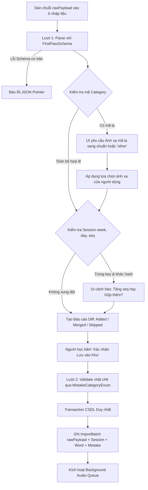

# ĐẶC TẢ ĐỊNH DẠNG & CỖ MÁY NHẬP LIỆU (IMPORT SPECIFICATION)

## 1. Phân định Hai Định dạng Dữ liệu JSON

Hệ thống phân định rạch ròi giữa hai loại tệp JSON với mục đích và cấu trúc hoàn toàn khác nhau:

1. **Định dạng 1: Dữ liệu Buổi học Hằng ngày (Daily Tutoring Session Export)**
   - **Nguồn gốc:** Do gia sư AI xuất ra sau mỗi buổi học 1 giờ với người học.
   - **Đặc điểm:** **TUYỆT ĐỐI KHÔNG CÓ TRƯỜNG `id`**. Dữ liệu mang tính ngữ nghĩa tự nhiên, phục vụ nạp từ mới, câu ví dụ và lỗi sai vào kho dữ liệu trung tâm.
   - **Trọng tâm tài liệu:** Toàn bộ Mục 2 đến Mục 6 của tài liệu này đặc tả chi tiết cho định dạng này.
2. **Định dạng 2: Dữ liệu Khôi phục Sao lưu Toàn vẹn (Full Database Backup Restore)**
   - **Nguồn gốc:** Do ứng dụng xuất ra từ tính năng "Xuất dữ liệu sao lưu" (`backup.service.ts`).
   - **Đặc điểm:** **BẮT BUỘC CHỨA ĐẦY ĐỦ TRƯỜNG `id` (CUID2)** của toàn bộ các bảng trong CSDL: `ImportBatch`, `StudyQuotaConfig`, `Session`, `SessionItem`, `Word`, `WordMeaning`, `Sentence`, `Mistake`, `ReviewState`, `ReviewLog`, `ReviewSession`.
   - **Mục đích:** Khôi phục nguyên vẹn toàn bộ dữ liệu và các mối quan hệ đa hình vào một CSDL trắng mà không làm thay đổi hay sai lệch ID.
   - **Quy trình Kiểm thử Khứ hồi (Round-trip Test):** Bộ kiểm thử tự động tại `tests/backup.test.ts` thực hiện quy trình: Xuất DB hiện tại ra file JSON $\rightarrow$ Xóa sạch toàn bộ bảng trong DB $\rightarrow$ Nhập lại từ file JSON $\rightarrow$ Đối chiếu từng bảng về số lượng bản ghi và giá trị các trường để xác nhận tính toàn vẹn. *(Xem chi tiết tại `docs/DATABASE_SCHEMA.md`)*.

---

## 2. Lược đồ Zod Định dạng Buổi học (Daily Session Schema)

Quá trình parse dữ liệu buổi học được thực hiện theo **2 lượt (Two-pass Validation)**:
- **Lượt 1 (First-pass / Ingestion Schema):** Tiếp nhận `category` dạng chuỗi tự do để phát hiện các mã lỗi lạ mà AI tutor sinh ra, từ đó hiển thị lên bảng Dry-run cho người dùng ánh xạ.
- **Lượt 2 (Strict / Commit Schema):** Sau khi người dùng đã xác nhận các ánh xạ mã lỗi, dữ liệu được kiểm thực chặt chẽ qua Enum trước khi ghi vào CSDL.

```typescript
import { z } from 'zod';

export const SUPPORTED_SCHEMA_VERSION = 1;

// Danh mục từ loại (Part of Speech) hợp lệ đầy đủ
export const PosEnum = z.enum([
  'noun',
  'verb',
  'adj',
  'adv',
  'phrase',
  'preposition',
  'conjunction',
  'pronoun',
  'determiner',
  'interjection'
]);

// Danh mục 13 mã lỗi chuẩn
export const MistakeCategoryEnum = z.enum([
  'plural-s',
  'subject-verb-agreement',
  'tense',
  'spelling',
  'article',
  'word-order',
  'preposition',
  'verb-pattern',
  'possessive',
  'sentence-structure',
  'capitalization-punctuation',
  'word-choice',
  'other'
]);

// Schema câu ví dụ
export const SentenceImportSchema = z.object({
  text: z.string().trim().min(1, 'Câu ví dụ không được để trống').max(300, 'Câu ví dụ tối đa 300 ký tự'),
  translationVi: z.string().trim().min(1, 'Nghĩa tiếng Việt không được để trống').max(300, 'Nghĩa tiếng Việt tối đa 300 ký tự'),
  targetForm: z.string().trim().min(1).max(100).optional() // Dạng chữ của từ trong câu phục vụ đục lỗ
});

// Schema từ vựng
export const WordImportSchema = z.object({
  word: z.string().trim().min(1, 'Từ vựng không được để trống').max(100, 'Từ vựng tối đa 100 ký tự'),
  pos: PosEnum,
  ipa: z.string().trim().max(100).optional(),
  meanings: z.array(z.string().trim().min(1).max(200, 'Mỗi nghĩa tối đa 200 ký tự')).min(1, 'Phải có ít nhất 1 nghĩa').max(10, 'Tối đa 10 nghĩa mỗi từ'),
  sentences: z.array(SentenceImportSchema).min(1, 'Phải có ít nhất 1 câu ví dụ').max(10, 'Tối đa 10 câu ví dụ mỗi từ')
});

// Schema lỗi sai ở Lượt 1 (category nhận chuỗi tự do để phát hiện mã lạ)
export const MistakeImportFirstPassSchema = z.object({
  wrong: z.string().trim().min(1, 'Câu sai không được để trống').max(300, 'Câu sai tối đa 300 ký tự'),
  correct: z.string().trim().min(1, 'Câu đúng không được để trống').max(300, 'Câu đúng tối đa 300 ký tự'),
  category: z.string().trim().min(1, 'Mã lỗi không được để trống').max(50),
  subCategory: z.string().trim().max(100).optional(),
  explanationVi: z.string().trim().min(1, 'Giải thích không được để trống').max(500, 'Giải thích tối đa 500 ký tự')
});

// Schema ngữ cảnh buổi học
export const SessionContextSchema = z.object({
  week: z.number().int().min(1, 'Tuần học phải >= 1'),
  day: z.number().int().min(1).max(7, 'Ngày trong tuần từ 1 đến 7'),
  seq: z.number().int().min(1).default(1),
  studiedAt: z.string().datetime({ message: 'Thời điểm studiedAt phải đúng định dạng ISO-8601 UTC' }).optional(),
  checkpoint: z.string().trim().min(1, 'Checkpoint không được để trống').max(200, 'Checkpoint tối đa 200 ký tự')
});

// Schema tổng thể cho payload buổi học (Lượt 1)
export const DailySessionPayloadFirstPassSchema = z.object({
  schemaVersion: z.literal(SUPPORTED_SCHEMA_VERSION, {
    error: `Phiên bản schemaVersion không được hỗ trợ. Ứng dụng hiện chỉ hỗ trợ phiên bản ${SUPPORTED_SCHEMA_VERSION}.`
  }),
  session: SessionContextSchema,
  words: z.array(WordImportSchema).max(50, 'Mỗi buổi học tối đa 50 từ vựng'),
  mistakes: z.array(MistakeImportFirstPassSchema).max(50, 'Mỗi buổi học tối đa 50 câu sai')
});
```

---

## 3. Cơ chế Phát hiện Trường Lạ, Mã Lỗi Lạ & Xung đột Khóa Session

### 3.1. Cơ chế Phát hiện Trường Lạ (Unknown Fields Detection)
- **Hạn chế của `.strip()`:** Phương thức `.strip()` của Zod loại bỏ trường lạ một cách âm thầm và **không tạo ra bất kỳ cảnh báo nào**.
- **Giải pháp triển khai thực tế:** Trong hàm `dryRunImport`, hệ thống so sánh danh sách các khóa (`Object.keys`) của đối tượng JSON đầu vào với tập hợp các khóa được định nghĩa trong `schema.shape`:
  ```typescript
  function detectUnknownKeys(raw: Record<string, unknown>, knownShape: Record<string, unknown>): string[] {
    const knownKeys = new Set(Object.keys(knownShape));
    return Object.keys(raw).filter(key => !knownKeys.has(key));
  }
  ```
  Các trường lạ được ghi nhận vào danh sách cảnh báo `warnings` của báo cáo Dry-run (ví dụ: *"Cảnh báo: trường 'difficulty' tại words[0] không nằm trong quy chuẩn và đã được lược bỏ"*), sau đó mới đưa qua parser để làm sạch dữ liệu.

### 3.2. Quy trình Xử lý Mã Lỗi Lạ (Unknown Mistake Category Re-mapping)
1. **Lượt 1 (First-pass):** Tiếp nhận `category` dưới dạng chuỗi tự do qua `MistakeImportFirstPassSchema`.
2. **Đối soát Whitelist:** Kiểm tra `MistakeCategoryEnum.options.includes(m.category)`:
   - Nếu mã thuộc 13 mã chuẩn: Hợp lệ.
   - Nếu mã lạ (ví dụ: `wrong-tense`, `verb-form`): Dòng lỗi được đánh dấu `REQUIRES_MAPPING`.
3. **Giao diện Ánh xạ (UI Re-mapping):** Người học chọn:
   - Ánh xạ về 1 trong 12 mã chuẩn (ví dụ: map `wrong-tense` $\rightarrow$ `tense`).
   - Hoặc chuyển thành `other` kèm gán `subCategory = "wrong-tense"`.
4. **Lưu vết và Tính Hash:**
   - **`ImportBatch.contentHash`:** Bắt buộc tính trên **chuỗi JSON rawPayload gốc** trước khi áp dụng bất kỳ ánh xạ nào để đảm bảo tính bất biến khi đối soát.
   - Các quyết định ánh xạ của người dùng được lưu trữ riêng biệt tại trường `remappingJson` (ví dụ: `{"wrong-tense": "tense"}`).
5. **Lượt 2 (Second-pass):** Dữ liệu sau ánh xạ được kiểm thực lại với schema nghiêm ngặt (`MistakeCategoryEnum` và ràng buộc `other` bắt buộc có `subCategory`) trước khi commit vào CSDL.

### 3.3. Xử lý Trùng Khóa Session `(week, day, seq)` Khác Nội dung
Khi người học import một buổi học có `(week, day, seq)` đã tồn tại trong CSDL:
- **So sánh Hash:** Hệ thống tính `sha256(rawPayload)` và so sánh với `ImportBatch.contentHash` của phiên cũ:
  - **Trường hợp A (Hash trùng khớp):** Báo trạng thái `SKIPPED`: *"Buổi học này đã được import đầy đủ trước đó"*.
  - **Trường hợp B (Hash khác nhau - Cùng khóa nhưng khác nội dung):** Hệ thống **TUYỆT ĐỐI KHÔNG GỘP ÂM THẦM**. Bước Dry-run phát cảnh báo `SESSION_KEY_CONFLICT` và hiển thị 2 lựa chọn cho người học:
    1. **Tăng số thứ tự phiên (`seq = seq + 1`):** Tạo thành một phiên học bổ sung riêng biệt trong cùng ngày (ví dụ: Week 1 Day 2 Phiên 2).
    2. **Gộp bổ sung (Merge & Append):** Giữ nguyên phiên học, gộp thêm các từ vựng và câu sai mới vào phiên hiện tại.

---

## 4. Quy tắc Chuẩn hóa & Gộp Dữ liệu (Normalization & Merge Rules)

### 4.1. Chuẩn hóa Từ vựng & Cụm từ (`normalizedWord`)
- Cắt khoảng trắng hai đầu: `.trim()`.
- Gộp các khoảng trắng liên tiếp bên trong (đặc biệt quan trọng với cụm từ `pos = 'phrase'`): `.replace(/\s+/g, ' ')`.
- Viết thường: `.toLowerCase()`.
- Chuẩn hóa Unicode dựng sẵn: `.normalize('NFC')`.
- *Ví dụ:* `"  Take   into   Account  "` $\rightarrow$ `"take into account"`.

### 4.2. Chuẩn hóa Văn bản Băm (`Sentence.text`, `Mistake.wrong`, `Mistake.correct`)
- Cắt khoảng trắng hai đầu: `.trim()`.
- Gộp các khoảng trắng liên tiếp: `.replace(/\s+/g, ' ')`.
- Chuẩn hóa Unicode: `.normalize('NFC')`.
- **BẢO TOÀN NGUYÊN VẸN CHỮ HOA/THƯỜNG VÀ DẤU CÂU:** Giữ nguyên trạng thái để bảo vệ giá trị lỗi chính tả và dấu câu.

### 4.3. Quy tắc Gộp Từ vựng (`Word` & `WordMeaning`)
- Khi từ vựng `(normalizedWord, pos)` đã tồn tại trong kho:
  - **Không ghi đè:** Giữ nguyên phiên âm `ipa` cũ và các nghĩa cũ; chỉ cập nhật `ipa` nếu bản ghi cũ đang để trống. Nếu `ipa` mới khác `ipa` cũ, ghi nhận cảnh báo `IPA_CONFLICT_WARNING` vào báo cáo.
  - **Khử trùng nghĩa tiếng Việt:** Nghĩa mới chỉ được thêm vào bảng `WordMeaning` nếu chuỗi nghĩa sau khi chuẩn hóa (`trim().replace(/\s+/g, ' ').normalize('NFC')`) chưa từng tồn tại trong danh sách nghĩa của từ đó.
  - **Câu ví dụ:** Thêm vào bảng `Sentence` nếu `(wordId, contentHash)` chưa tồn tại; nếu câu ví dụ đã có sẵn thì bỏ qua.
  - **Tiến trình SRS:** Giữ nguyên trạng thái `ReviewState` hiện tại của từ vựng, không reset interval.

### 4.4. Khử trùng Lỗi Lặp trong Cùng một Payload
- Nếu trong cùng một file import xuất hiện 2 mục `Mistake` có cùng `contentHash`:
- Hệ thống tự động gộp thành 1 mục duy nhất, ghi cảnh báo `DUPLICATE_MISTAKE_IN_PAYLOAD`, nhằm ngăn ngừa lỗi vi phạm ràng buộc duy nhất `SessionItem(sessionId, itemType, itemId)`.

---

## 5. Danh mục 13 Mã Lỗi Chuẩn (Single Source of Truth)

| Mã chuẩn (kebab-case) | Nhãn tiếng Việt | Mô tả tóm tắt |
| :--- | :--- | :--- |
| `plural-s` | Lỗi thiếu/thừa 's' số nhiều | Quên s/es ở danh từ đếm được hoặc thêm nhầm vào danh từ không đếm được |
| `subject-verb-agreement` | Hòa hợp chủ vị | Bất đồng giữa chủ ngữ số ít/nhiều và dạng chia động từ |
| `tense` | Sai thì động từ | Dùng sai thì so với trạng từ chỉ thời gian hoặc ngữ cảnh câu |
| `spelling` | Lỗi chính tả từ vựng | Viết sai vị trí hoặc thiếu ký tự tiếng Anh |
| `article` | Mạo từ (a, an, the) | Thiếu, thừa hoặc dùng sai mạo từ xác định/không xác định |
| `word-order` | Trật tự từ trong câu | Sai vị trí trạng từ, tính từ hoặc trật tự từ trong câu |
| `preposition` | Giới từ | Dùng sai giới từ đi kèm động từ, tính từ hoặc mốc thời gian/địa điểm |
| `verb-pattern` | Dạng của động từ | Dùng sai V-ing, to-V hoặc động từ nguyên thể sau động từ đặc biệt |
| `possessive` | Lỗi sở hữu cách | Dùng sai dấu 's hoặc nhầm tính từ sở hữu và đại từ sở hữu |
| `sentence-structure` | Cấu trúc câu thiếu thành phần | Câu thiếu chủ ngữ, thiếu vị ngữ hoặc câu què (fragment) |
| `capitalization-punctuation` | Viết hoa & Dấu câu | Quên viết hoa đầu câu/tên riêng; dấu phẩy ngắt câu sai quy tắc |
| `word-choice` | Dùng từ chưa chuẩn xác | Dùng từ sai ngữ cảnh hoặc collocation không tự nhiên |
| `other` | Lỗi khác | Các lỗi ngữ pháp/từ vựng đặc thù khác (bắt buộc kèm `subCategory`) |

---

## 6. Sơ đồ Luồng Xử lý Dry-run & Báo cáo Minh họa



---

## 7. Mẫu Dữ liệu Thực tế (Fixtures)

### 7.1. Mẫu File Hợp lệ Hoàn chỉnh
File fixture mẫu chuẩn đạt tiêu chuẩn kiểm thử tự động được lưu tại đường dẫn tương đối:  
[`tests/fixtures/session_valid_sample.json`](file:///d:/Antigravity/learn_languege_app/tests/fixtures/session_valid_sample.json)  
*(Toàn bộ nội dung sử dụng dữ liệu IELTS giả lập, đã được chạy kiểm tra thực tế bằng TypeScript và Zod 4)*.

### 7.2. Mẫu File Lỗi & Cấu trúc Báo cáo Dry-run

#### Chuỗi JSON lỗi đầu vào:
```json
{
  "schemaVersion": 1,
  "session": {
    "week": 1,
    "day": 2,
    "seq": 1,
    "checkpoint": "Học hiện tại đơn"
  },
  "words": [
    {
      "word": "improve",
      "pos": "verb",
      "meanings": ["cải thiện"],
      "sentences": [
        {
          "text": "I want to improve my speaking score.",
          "translationVi": "Tôi muốn cải thiện điểm nói."
        }
      ],
      "difficulty": "medium"
    }
  ],
  "mistakes": [
    {
      "wrong": "He go home",
      "correct": "He goes home",
      "category": "wrong-verb-form",
      "explanationVi": "Chủ ngữ He đi với goes"
    }
  ]
}
```

#### Báo cáo Dry-run trả về (Cấu trúc TypeScript):
```json
{
  "isValid": true,
  "requiresUserAction": true,
  "summary": {
    "addedWordsCount": 1,
    "mergedWordsCount": 0,
    "newSentencesCount": 1,
    "addedMistakesCount": 1,
    "skippedMistakesCount": 0,
    "reappearedMistakesCount": 0,
    "warningCount": 1,
    "errorCount": 0
  },
  "warnings": [
    {
      "path": "/words/0/difficulty",
      "message": "Trường 'difficulty' không nằm trong quy chuẩn và đã được lược bỏ."
    }
  ],
  "pendingMappings": [
    {
      "itemIndex": 0,
      "wrongText": "He go home",
      "unknownCategory": "wrong-verb-form",
      "suggestedOptions": [
        { "code": "subject-verb-agreement", "label": "Hòa hợp chủ vị" },
        { "code": "verb-pattern", "label": "Dạng của động từ" },
        { "code": "other", "label": "Khác (lấy 'wrong-verb-form' làm subCategory)" }
      ]
    }
  ]
}
```

---

## 8. An toàn Bảo mật & Chống XSS (Security Rules)

- **Nguyên tắc cốt lõi:** Nội dung JSON xuất từ AI tutor được coi là **dữ liệu không đáng tin cậy (Untrusted Input)**.
- **Quy tắc giao diện:**
  - **Tuyệt đối không sử dụng** `dangerouslySetInnerHTML` để render bất kỳ trường dữ liệu nào từ file import (`meaningVi`, `explanationVi`, `sentence.text`, `mistake.wrong`).
  - Toàn bộ chuỗi văn bản bắt buộc được hiển thị qua các **React Text Nodes chuẩn** (React tự động escape toàn bộ các ký tự `<, >, &, ", '`).
  - Các đoạn hiển thị tô màu khác biệt (Diff View) giữa câu gõ và câu đúng được xây dựng bằng cách bọc từng từ trong các thẻ `<span>` với class riêng biệt, không nối chuỗi HTML thô.

---

## 9. Câu hỏi còn mở (Open Questions)

### Câu hỏi 1: Lưu trữ file import gốc sau khi xử lý thành công
- **Phương án A (Khuyến nghị):** Lưu nguyên văn chuỗi JSON vào cột `rawPayload` của bảng `ImportBatch` trong CSDL SQLite.
  - *Ưu điểm:* Gọn gàng, dữ liệu đi liền với DB, tự động được sao lưu cùng lệnh `VACUUM INTO`.
- **Phương án B:** Lưu thành từng file vật lý độc lập trong thư mục `/data/imports/session_w{week}_d{day}_{seq}.json`.
  - *Ưu điểm:* Dễ mở kiểm tra bằng text editor ngoài mà không cần mở DB.
  - *Nhược điểm:* Phải quản lý thêm thư mục và phân quyền file hệ thống.

### Câu hỏi 2: Xử lý khi câu ví dụ xuất ra quá dài (>300 ký tự)
- **Phương án A (Khuyến nghị):** Giới hạn cứng độ dài câu ví dụ tối đa `300 ký tự` qua Zod (`z.string().max(300)`). Nếu câu quá dài, bước Dry-run sẽ báo lỗi để người học yêu cầu AI rút gọn thành câu ngắn đơn nghĩa, chuẩn bị tốt nhất cho bài tập đục lỗ ở Phase B.
- **Phương án B:** Cho phép độ dài tự do và hệ thống tự động ngắt câu bằng thuật toán tách câu (`Intl.Segmenter`).
  - *Nhược điểm:* Có thể ngắt nhầm ở các chữ viết tắt tiếng Anh (ví dụ: *e.g.*, *i.e.*, *Dr.*, *U.S.*).

---

## 10. Nhật ký Quyết định (Decision Log / ADR)

| Ngày | Quyết định | Lý do kỹ thuật | Phương án đã loại |
| :--- | :--- | :--- | :--- |
| **2026-10-17** | **Lưu raw JSON trong `ImportBatch.rawPayload`.** | Tập trung toàn bộ dữ liệu vào SQLite; sao lưu và khôi phục đồng bộ qua `VACUUM INTO` mà không lo rò rỉ file ngoài ổ đĩa. | Lưu file `.json` rời rạc trên filesystem. |
| **2026-10-17** | **Giới hạn cứng câu ví dụ tối đa 300 ký tự.** | Đảm bảo câu ngắn gọn, rõ ngữ cảnh phục vụ bài tập đục lỗ và hiển thị Flashcard đẹp mắt; tránh đoạn văn dài gây quá tải giao diện. | Cho phép câu dài tự do và tự ngắt bằng NLP regex. |
| **2026-10-17** | **Two-pass validation cho mã danh mục lỗi.** | Lượt 1 tiếp nhận chuỗi tự do để phát hiện mã lỗi lạ và cho người dùng ánh xạ ở Dry-run; lượt 2 validate enum nghiêm ngặt trước khi commit. | Chặn ngay ở lượt parse đầu tiên bằng Enum cứng (khiến người học không thấy được ngữ cảnh lỗi sai để map). |
| **2026-10-17** | **Xung đột khóa Session `(week, day, seq)` cảnh báo rõ ràng.** | Ngăn chặn việc ghi đè hoặc gộp dữ liệu âm thầm khi hai file học khác nhau bị trùng mốc tuần/ngày; cho phép chọn tăng `seq` hoặc gộp bổ sung. | Tự động ghi đè hoặc âm thầm merge dữ liệu. |
| **2026-10-17** | **Khử trùng lỗi lặp trong cùng payload.** | Ngăn chặn lỗi vi phạm khóa duy nhất `SessionItem(sessionId, itemType, itemId)` khi AI tutor vô tình xuất 2 câu sai giống hệt nhau trong 1 file. | Ném lỗi database làm hỏng toàn bộ transaction import. |
