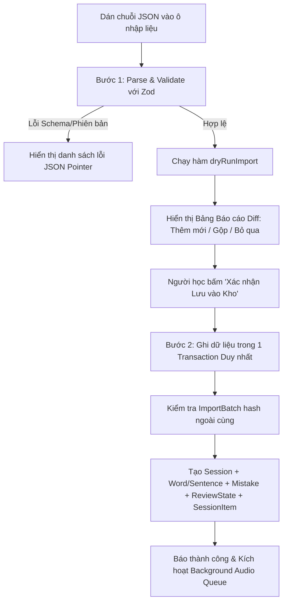

# ĐẶC TẢ ĐỊNH DẠNG & CỖ MÁY NHẬP LIỆU (IMPORT SPECIFICATION)

## 1. Phân định Hai Định dạng Dữ liệu JSON

Hệ thống phân định rạch ròi giữa hai loại tệp JSON với mục đích và cấu trúc hoàn toàn khác nhau:

1. **Định dạng 1: Dữ liệu Buổi học Hằng ngày (Daily Tutoring Session Export)**
   - **Nguồn gốc:** Do gia sư AI xuất ra sau mỗi buổi học 1 giờ với người học.
   - **Đặc điểm:** **TUYỆT ĐỐI KHÔNG CÓ TRƯỜNG `id`**. Dữ liệu mang tính ngữ nghĩa tự nhiên, phục vụ nạp từ mới và câu sai vào kho dữ liệu trung tâm.
   - **Trọng tâm tài liệu:** Phần lớn nội dung file spec này quy định chi tiết cho định dạng này.
2. **Định dạng 2: Dữ liệu Khôi phục Sao lưu Toàn vẹn (Full Database Backup Restore)**
   - **Nguồn gốc:** Do ứng dụng xuất ra từ tính năng "Xuất dữ liệu sao lưu" (`backup.service.ts`).
   - **Đặc điểm:** **BẮT BUỘC CHỨA ĐẦY ĐỦ TRƯỜNG `id` (CUID2)** của toàn bộ các bảng trong CSDL (`Session`, `SessionItem`, `Word`, `WordMeaning`, `Sentence`, `Mistake`, `ReviewState`, `ReviewLog`, `ReviewSession`).
   - **Mục đích:** Khôi phục nguyên vẹn 100% dữ liệu và quan hệ đa hình vào một CSDL trắng mà không làm sai lệch ID. *(Chi tiết cấu trúc xem tại `docs/DATABASE_SCHEMA.md` và `docs/TECH_STACK.md`)*.

---

## 2. Lược đồ Zod Định dạng Buổi học (Daily Session Schema)

```typescript
import { z } from 'zod';

export const SUPPORTED_SCHEMA_VERSION = 1;

// Danh mục từ loại (Part of Speech) hợp lệ
export const PosEnum = z.enum([
  'noun',
  'verb',
  'adj',
  'adv',
  'phrase',
  'preposition',
  'conjunction'
]);

// Danh mục 13 mã lỗi chuẩn
export const MistakeCategoryEnum = z.enum([
  'plural-s',
  'subject-verb-agreement',
  'tense',
  'spelling',
  'article',
  'word-order',
  'preposition',
  'verb-pattern',
  'possessive',
  'sentence-structure',
  'capitalization-punctuation',
  'word-choice',
  'other'
]);

// Schema câu ví dụ
export const SentenceImportSchema = z.object({
  text: z.string().min(1, 'Câu ví dụ không được để trống').max(300, 'Câu ví dụ tối đa 300 ký tự'),
  translationVi: z.string().min(1, 'Nghĩa tiếng Việt của câu không được để trống'),
  targetForm: z.string().optional() // Dạng chữ của từ trong câu phục vụ đục lỗ
}).strip();

// Schema từ vựng
export const WordImportSchema = z.object({
  word: z.string().min(1, 'Từ vựng không được để trống'),
  pos: PosEnum,
  ipa: z.string().optional(),
  meanings: z.array(z.string().min(1)).min(1, 'Phải có ít nhất 1 nghĩa tiếng Việt'),
  sentences: z.array(SentenceImportSchema).min(1, 'Phải có ít nhất 1 câu ví dụ')
}).strip();

// Schema lỗi sai
export const MistakeImportSchema = z.object({
  wrong: z.string().min(1, 'Câu sai không được để trống').max(300),
  correct: z.string().min(1, 'Câu đúng không được để trống').max(300),
  category: MistakeCategoryEnum,
  subCategory: z.string().optional(),
  explanationVi: z.string().min(1, 'Giải thích không được để trống')
}).refine(
  (data) => data.category !== 'other' || (data.subCategory && data.subCategory.trim().length > 0),
  {
    message: "Khi category là 'other', bắt buộc phải cung cấp 'subCategory'",
    path: ['subCategory']
  }
).strip();

// Schema ngữ cảnh buổi học
export const SessionContextSchema = z.object({
  week: z.number().int().min(1, 'Tuần học phải >= 1'),
  day: z.number().int().min(1).max(7, 'Ngày trong tuần từ 1 đến 7'),
  seq: z.number().int().min(1).default(1),
  studiedAt: z.string().datetime().optional(), // Chuỗi ISO-8601 UTC
  checkpoint: z.string().min(1, 'Mục tiêu checkpoint không được để trống')
}).strip();

// Schema tổng thể cho payload buổi học
export const DailySessionPayloadSchema = z.object({
  schemaVersion: z.literal(SUPPORTED_SCHEMA_VERSION, {
    errorMap: () => ({ message: `Phiên bản schemaVersion không được hỗ trợ. Ứng dụng hiện chỉ hỗ trợ phiên bản ${SUPPORTED_SCHEMA_VERSION}.` })
  }),
  session: SessionContextSchema,
  words: z.array(WordImportSchema).max(50, 'Mỗi buổi học tối đa 50 từ vựng'),
  mistakes: z.array(MistakeImportSchema).max(50, 'Mỗi buổi học tối đa 50 câu sai')
}).strip();
```

### 2.1. Quy tắc với Trường Lạ (Unknown Fields) & Giới hạn Tải
- **Xử lý trường lạ:** Sử dụng `.strip()` trong Zod. Các trường ngoài định nghĩa (ví dụ AI tự thêm `notes`, `difficulty`) sẽ được **tự động loại bỏ** để không làm ô nhiễm CSDL, đồng thời ghi nhận cảnh báo nhẹ (Warning) trong kết quả Dry-run để người dùng theo dõi.
- **Giới hạn an toàn (Resource Limits):**
  - Kích thước payload tối đa: **1 MB** (chặn ngay ở tầng Route Handler trước khi parse JSON).
  - Số lượng tối đa trong 1 buổi: **50 từ vựng** và **50 lỗi sai** (đảm bảo phù hợp tải của 1 phiên học 1 giờ).

---

## 3. Quy tắc Chuẩn hóa Dữ liệu (Normalization Rules)

1. **Chuẩn hóa Từ vựng (`Word.normalizedWord`):**
   - Viết thường hoàn toàn: `.toLowerCase()`.
   - Cắt khoảng trắng thừa hai đầu: `.trim()`.
   - Chuẩn hóa Unicode dựng sẵn: `.normalize('NFC')`.
2. **Quy tắc Từ loại Cụm từ (`pos = 'phrase'`):**
   - Áp dụng khi mục học là một thành ngữ (idiom), cụm động từ (phrasal verb) hoặc cụm từ cố định (collocation) gồm nhiều từ ghép lại (ví dụ: *"take into account"*, *"make progress"*).
3. **Chuẩn hóa Văn bản Băm (`Sentence.text`, `Mistake.wrong`, `Mistake.correct`):**
   - Cắt khoảng trắng hai đầu: `.trim()`.
   - Gộp khoảng trắng liên tiếp: `.replace(/\s+/g, ' ')`.
   - Chuẩn hóa Unicode: `.normalize('NFC')`.
   - **BẢO TOÀN NGUYÊN VẸN CHỮ HOA/THƯỜNG VÀ DẤU CÂU:** Tuyệt đối không gọi `.toLowerCase()` hay xóa dấu chấm, phẩy để giữ đúng bản chất lỗi chính tả và lỗi viết hoa trong IELTS.

---

## 4. Danh mục 13 Mã Lỗi Chuẩn & Cơ chế Ánh xạ Mã lạ (Re-mapping)

### 4.1. Danh mục Nguồn Sự thật Duy nhất (Single Source of Truth)
Được định nghĩa tập trung tại `src/lib/constants/mistake-categories.ts`:

| Mã chuẩn (kebab-case) | Nhãn tiếng Việt | Mô tả tóm tắt |
| :--- | :--- | :--- |
| `plural-s` | Lỗi thiếu/thừa 's' số nhiều | Quên s/es ở danh từ đếm được hoặc thêm nhầm vào danh từ không đếm được |
| `subject-verb-agreement` | Hòa hợp chủ vị | Bất đồng giữa chủ ngữ số ít/nhiều và dạng chia động từ |
| `tense` | Sai thì động từ | Dùng sai thì so với trạng từ chỉ thời gian hoặc ngữ cảnh câu |
| `spelling` | Lỗi chính tả từ vựng | Viết sai vị trí hoặc thiếu ký tự tiếng Anh |
| `article` | Mạo từ (a, an, the) | Thiếu, thừa hoặc dùng sai mạo từ xác định/không xác định |
| `word-order` | Trật tự từ trong câu | Sai vị trí trạng từ, tính từ hoặc trật tự từ trong câu hỏi/phụ |
| `preposition` | Giới từ | Dùng sai giới từ đi kèm động từ, tính từ hoặc mốc thời gian/địa điểm |
| `verb-pattern` | Dạng của động từ | Dùng sai V-ing, to-V hoặc động từ nguyên thể sau các động từ đặc biệt |
| `possessive` | Lỗi sở hữu cách | Dùng sai dấu 's hoặc nhầm tính từ sở hữu và đại từ sở hữu |
| `sentence-structure` | Cấu trúc câu thiếu thành phần | Câu thiếu chủ ngữ, thiếu vị ngữ hoặc câu què (fragment) |
| `capitalization-punctuation` | Viết hoa & Dấu câu | Quên viết hoa đầu câu/tên riêng; dấu phẩy nối câu sai quy tắc |
| `word-choice` | Dùng từ chưa chuẩn xác | Dùng từ sai ngữ cảnh hoặc collocation không tự nhiên |
| `other` | Lỗi khác | Các lỗi ngữ pháp/từ vựng đặc thù khác (bắt buộc kèm `subCategory`) |

### 4.2. Cơ chế Phát hiện & Ánh xạ Mã Lạ tại Dry-run
- Khi AI tutor xuất một mã lỗi nằm ngoài 13 mã trên (ví dụ: `wrong-tense` hoặc `verb-form`):
- Hệ thống **chặn lại ở bước Dry-run** và hiển thị cảnh báo tại dòng đó.
- Giao diện cung cấp cho người học 2 lựa chọn xử lý tức thì:
  1. **Ánh xạ về mã chuẩn:** Chọn map `wrong-tense` $\rightarrow$ `tense`.
  2. **Chuyển thành nhóm `other`:** Tự động gán `category = "other"` và lấy chuỗi `"wrong-tense"` làm giá trị cho trường `subCategory`.

---

## 5. Quy trình 2 Bước: Dry-run Đối soát & Atomic Commit



### 5.1. Báo cáo Phân tích Đối soát (Dry-run Diff Report)
Giao diện phân loại chi tiết từng phần tử kèm đường dẫn JSON Pointer:
- **`Thêm mới (Added)`:** Từ vựng chưa từng có, câu ví dụ mới, lỗi sai mới xuất hiện lần đầu.
- **`Gộp dữ liệu (Merged)`:** Từ vựng đã tồn tại trong kho $\rightarrow$ giữ nguyên tiến trình SRS cũ, bổ sung nghĩa tiếng Việt mới vào `WordMeaning` hoặc câu ví dụ mới vào `Sentence`.
- **`Bỏ qua (Skipped)`:** Cặp câu sai/đúng của `Mistake` đã tồn tại y hệt $\rightarrow$ ghi nhận thêm 1 bản ghi `SessionItem (REAPPEARED)` để đếm số lần mắc, không tạo thêm dòng `Mistake`. Câu ví dụ trùng hash nội dung cho cùng một từ $\rightarrow$ bỏ qua.
- **`Lỗi dữ liệu (Errors)`:** Báo lỗi rõ ràng kèm vị trí, ví dụ: `/words/1/sentences/0/text`.

### 5.2. Chống Trùng lặp 2 Lớp (Idempotent Defense)
1. **Lớp ngoài cùng (`ImportBatch`):** Tính `sha256(rawPayload)`. Nếu hash này đã có trong bảng `ImportBatch`, hệ thống lập tức thông báo: *"Buổi học này đã được import thành công trước đó!"* mà không cần thực thi câu lệnh truy vấn nào lên các bảng thực thể.
2. **Lớp thực thể cốt lõi:** Dựa trên khóa tự nhiên `Session(week, day, seq)` và các hàm băm `Sentence(wordId, contentHash)` cùng `Mistake(contentHash)`. Dù người học dán file với định dạng khoảng trắng khác, tính idempotent vẫn được bảo toàn 100%.

---

## 6. An toàn Bảo mật & Chống XSS (Security Rules)

- **Nguyên tắc cốt lõi:** Nội dung JSON xuất từ AI tutor được coi là **dữ liệu không đáng tin cậy (Untrusted Input)**. AI có thể vô tình hoặc cố ý xuất các chuỗi chứa mã độc HTML/JavaScript (ví dụ: `<script>alert('XSS')</script>` hoặc `onclick=...`).
- **Quy tắc giao diện:**
  - **Tuyệt đối không sử dụng** `dangerouslySetInnerHTML` để render bất kỳ trường dữ liệu nào từ file import (`meaningVi`, `explanationVi`, `sentence.text`, `mistake.wrong`).
  - Toàn bộ chuỗi văn bản bắt buộc được hiển thị qua các **React Text Nodes chuẩn** (React tự động mã hóa escape toàn bộ các ký tự `<, >, &, ", '`).
  - Các đoạn hiển thị tô màu khác biệt (Diff View) giữa câu gõ và câu đúng được xây dựng bằng cách bọc từng từ trong các thẻ `<span>` với class riêng biệt, không nối chuỗi HTML thô.

---

## 7. Mẫu Dữ liệu Thực tế (Fixtures)

### 7.1. Mẫu File Hợp lệ Hoàn chỉnh
File mẫu chuẩn đã được lưu tại [tests/fixtures/session_valid_sample.json](file:///d:/Antigravity/learn_languege_app/tests/fixtures/session_valid_sample.json) chứa đầy đủ dữ liệu từ vựng, từ loại, phiên âm IPA, câu ví dụ có `targetForm` và các lỗi sai ngữ pháp IELTS phổ biến.

### 7.2. Mẫu File Lỗi & Báo cáo Dry-run Minh họa

#### Chuỗi JSON lỗi đầu vào:
```json
{
  "schemaVersion": 2,
  "session": {
    "week": 0,
    "day": 8,
    "checkpoint": ""
  },
  "words": [
    {
      "word": "improve",
      "pos": "verb",
      "meanings": [],
      "sentences": []
    }
  ],
  "mistakes": [
    {
      "wrong": "He go home",
      "correct": "He goes home",
      "category": "invalid-category-code",
      "explanationVi": ""
    }
  ]
}
```

#### Báo cáo Dry-run trả về (Cấu trúc có thể lập trình):
```json
{
  "isValid": false,
  "summary": { "addedWords": 0, "mergedWords": 0, "skippedSentences": 0, "addedMistakes": 0, "errorCount": 6 },
  "errors": [
    {
      "path": "/schemaVersion",
      "message": "Phiên bản schemaVersion không được hỗ trợ. Ứng dụng hiện chỉ hỗ trợ phiên bản 1."
    },
    {
      "path": "/session/week",
      "message": "Tuần học phải >= 1"
    },
    {
      "path": "/session/day",
      "message": "Ngày trong tuần từ 1 đến 7"
    },
    {
      "path": "/words/0/meanings",
      "message": "Phải có ít nhất 1 nghĩa tiếng Việt"
    },
    {
      "path": "/words/0/sentences",
      "message": "Phải có ít nhất 1 câu ví dụ"
    },
    {
      "path": "/mistakes/0/category",
      "message": "Mã danh mục 'invalid-category-code' không hợp lệ. Cần ánh xạ sang 1 trong 13 mã chuẩn."
    }
  ]
}
```

---

## 8. Câu hỏi còn mở (Open Questions)

### Câu hỏi 1: Lưu trữ file import gốc sau khi xử lý thành công
- **Phương án A (Khuyến nghị):** Lưu nguyên văn chuỗi JSON vào cột `rawPayload` của bảng `ImportBatch` trong CSDL SQLite.
  - *Ưu điểm:* Gọn gàng, dữ liệu đi liền với DB, tự động được sao lưu cùng lệnh `VACUUM INTO`.
- **Phương án B:** Lưu thành từng file vật lý độc lập trong thư mục `/data/imports/session_w{week}_d{day}_{seq}.json`.
  - *Ưu điểm:* Dễ mở kiểm tra bằng text editor ngoài mà không cần mở DB.
  - *Nhược điểm:* Phải quản lý thêm thư mục và phân quyền file hệ thống.

### Câu hỏi 2: Xử lý khi câu ví dụ xuất ra quá dài hoặc là một đoạn văn
- **Phương án A (Khuyến nghị):** Giới hạn cứng độ dài câu ví dụ tối đa `300 ký tự` qua Zod (`z.string().max(300)`). Nếu câu quá dài, bước Dry-run sẽ báo lỗi để người học yêu cầu AI rút gọn thành câu ngắn đơn nghĩa, chuẩn bị tốt nhất cho bài tập đục lỗ ở Phase B.
- **Phương án B:** Cho phép độ dài tự do và hệ thống tự động ngắt câu bằng thuật toán tách câu (`Intl.Segmenter`).
  - *Nhược điểm:* Có thể ngắt nhầm ở các chữ viết tắt tiếng Anh (ví dụ: *e.g.*, *i.e.*, *Dr.*, *U.S.*).

---

## 9. Nhật ký Quyết định (Decision Log / ADR)

| Ngày | Quyết định | Lý do kỹ thuật | Phương án đã loại |
| :--- | :--- | :--- | :--- |
| **2026-10-17** | **Tách biệt định dạng Import buổi học (không ID) và Khôi phục (có ID).** | Tránh nhầm lẫn vai trò: file buổi học mang tính tích lũy kiến thức tự nhiên; file khôi phục mang tính sao lưu trạng thái hệ thống. | Dùng chung 1 định dạng (buộc file buổi học phải sinh ID giả hoặc làm đứt gãy quan hệ đa hình). |
| **2026-10-17** | **Kiểm tra `schemaVersion` nghiêm ngặt.** | Bảo vệ tính toàn vẹn của ứng dụng khi cấu trúc import thay đổi theo các phase sau; chặn ngay lập tức nếu phiên bản không khớp. | Không kiểm tra phiên bản (dễ gây lỗi runtime khó hiểu khi thiếu trường). |
| **2026-10-17** | **Zod dùng `.strip()` loại bỏ trường lạ kèm warning ở Dry-run.** | Đảm bảo tính linh hoạt khi AI tutor tự ý xuất thêm trường ngoài ý muốn, không làm hỏng trải nghiệm người học nhưng vẫn giữ CSDL sạch sẽ. | Chặn hoàn toàn bằng `.strict()` (gây khó chịu khi AI xuất thêm một thuộc tính phụ). |
| **2026-10-17** | **Cấm dùng `dangerouslySetInnerHTML`, 100% render qua React text nodes.** | Triệt tiêu hoàn toàn rủi ro Stored XSS từ chuỗi văn bản không đáng tin cậy của AI tutor. | Cho phép render HTML thô để hiển thị in đậm/in nghiêng (tiềm ẩn lỗ hổng bảo mật). |
| **2026-10-17** | **Dry-run định vị lỗi qua JSON Pointer.** | Giúp người học nhìn thấy chính xác từ nào, câu nào trong file JSON bị lỗi để sửa nhanh hoặc báo lại cho AI tutor. | Báo lỗi chung chung "File import không hợp lệ". |
