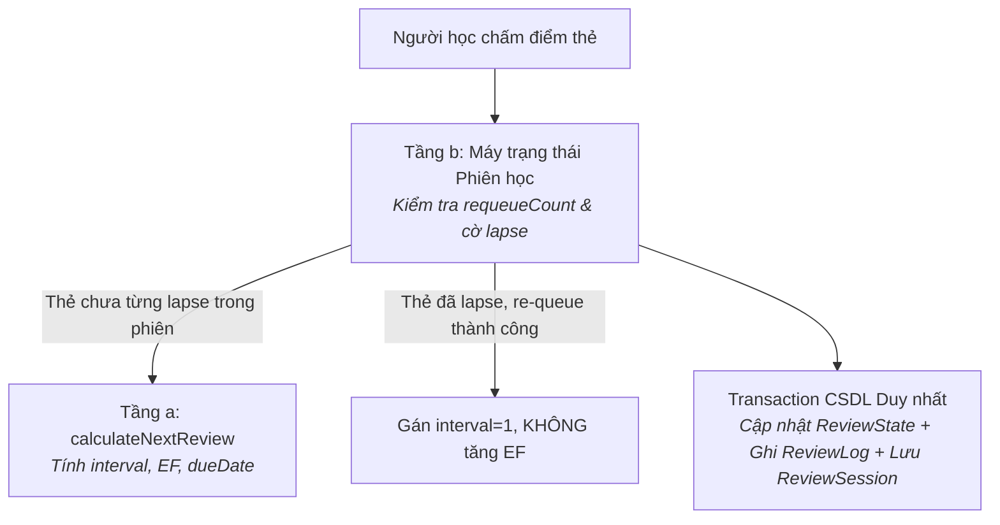

# ĐẶC TẢ THUẬT TOÁN LẶP LẠI NGẮT QUÃNG (SRS ALGORITHM SPECIFICATION)

## 1. Bảng Định nghĩa Hằng số Thuật toán (Modified SM-2)

Thuật toán SRS trong dự án được điều chỉnh từ SM-2 kinh điển để phù hợp với thang 3 nút đánh giá (*Quên / Khó nhớ / Nhớ rõ*), tối ưu cho người học IELTS với quỹ thời gian 1 giờ mỗi ngày.

| Tên Hằng số | Giá trị | Vai trò / Công thức áp dụng | Lý do chọn lựa kỹ thuật |
| :--- | :--- | :--- | :--- |
| `INITIAL_EASE_FACTOR` | `2.50` | Hệ số dễ nhớ khởi điểm của thẻ mới | Chuẩn mực của thuật toán SM-2; độ co giãn giãn cách 250% là điểm cân bằng tốt cho người mới bắt đầu. |
| `MIN_EASE_FACTOR` | `1.30` | Sàn Ease Factor tối thiểu (không thể tụt dưới mức này) | Ngăn ngừa hiện tượng "Ease Hell" (thẻ bị kẹt ở hệ số quá thấp khiến ngày nào cũng phải ôn lặp lại vô ích). |
| `FIRST_INTERVAL` | `1` ngày | Khoảng cách sau lần đầu tiên trả lời đúng | Đảm bảo củng cố trí nhớ ngắn hạn sau 24 giờ kể từ khi nạp từ mới. |
| `SECOND_INTERVAL` | `4` ngày | Khoảng cách sau lần thứ hai trả lời "Nhớ rõ" | *(Giá trị khởi điểm, sẽ tinh chỉnh sau khi có dữ liệu ReviewLog)* Bước đệm 4 ngày giúp kiến thức chuyển từ trí nhớ ngắn hạn sang trung hạn trước khi áp dụng hệ số nhân EF. |
| `HARD_MULTIPLIER` | `1.20` | Hệ số nhân khoảng cách khi đánh giá "Khó nhớ" | Giúp thẻ giãn cách chậm hơn bình thường (chỉ tăng 20%) để củng cố lại. |
| `MIN_HARD_INTERVAL_INCREASE` | `1` ngày | Bước tăng tối thiểu khi đánh giá "Khó nhớ" | Triệt tiêu lỗi kẹt khoảng cách: nếu `interval = 1`, `max(1 + 1, ceil(1 * 1.2)) = 2` (tăng ít nhất 1 ngày), không bao giờ bị dậm chân tại chỗ. |
| `FORGOTTEN_EF_DELTA` | `-0.20` | Mức giảm Ease Factor khi bấm "Quên" | Phạt độ khó khi người học quên từ; **chỉ áp dụng duy nhất 1 lần trong phiên** dù thẻ bị re-queue nhiều lần. |
| `HARD_EF_DELTA` | `-0.15` | Mức giảm Ease Factor khi bấm "Khó nhớ" | Giảm nhẹ độ dễ nhớ để từ này xuất hiện thường xuyên hơn ở các vòng sau. |
| `REMEMBERED_EF_DELTA` | `+0.10` | Mức tăng Ease Factor khi bấm "Nhớ rõ" | Tưởng thưởng khi nhớ tốt, giúp thẻ giãn cách xa hơn ở các chu kỳ tiếp theo. |
| `MAX_INTRA_SESSION_REQUEUES` | `3` lần | Số lần tối đa một thẻ "Quên" được xuất hiện lại trong phiên | Tránh vòng lặp vô tận gây ức chế khi người học gặp từ quá khó trong buổi học 1 giờ. |

---

## 2. Kiến trúc Hai Lớp: Bộ tính Lịch ôn & Máy trạng thái Phiên học

Để đảm bảo tính độc lập và khả năng kiểm thử tối đa, hệ thống phân tách rõ rệt thành hai tầng:
- **Tầng (a): Bộ tính lịch ôn toán học thuần túy (`calculateNextReview`)**: Hoàn toàn là pure function, tính toán các chỉ số mới và `dueDate` độc lập với trạng thái giao diện.
- **Tầng (b): Máy trạng thái phiên học (`processSessionCard`)**: Điều phối luồng học trong phiên, quản lý re-queue thẻ quên, chặn phạt lapse nhiều lần, và lưu trạng thái vào CSDL.



### 2.1. Tầng (a): Bộ tính Lịch ôn Thuần túy (`calculateNextReview`)

#### Chữ ký hàm (Signature):
```typescript
export type Rating = 'FORGOTTEN' | 'HARD' | 'REMEMBERED';

export interface ReviewStateInput {
  interval: number;       // Khoảng cách hiện tại (ngày)
  easeFactor: number;     // Hệ số Ease Factor hiện tại
  repetitions: number;    // Số lần đạt chuẩn liên tiếp
  lapseCount: number;     // Tổng số lần bị quên trong lịch sử
}

export interface ReviewStateOutput {
  interval: number;
  easeFactor: number;
  repetitions: number;
  lapseCount: number;
  dueDate: string;        // Chuỗi ngày học YYYY-MM-DD
}

export interface SrsScheduler {
  calculateNextReview(
    state: ReviewStateInput,
    rating: Rating,
    now: Date
  ): ReviewStateOutput;
}
```

#### Quy tắc toán học & Làm tròn:
1. **Làm tròn Ease Factor:** Sau mỗi lần cộng/trừ, Ease Factor bắt buộc được **làm tròn đến 2 chữ số thập phân**:
   $$\text{easeFactor} = \text{Math.round}(\text{rawEF} \times 100) / 100$$
2. **Quy tắc nút bấm:**
   - **`FORGOTTEN`:**
     $$\text{interval} = 1, \quad \text{repetitions} = 0, \quad \text{lapseCount} = \text{lapseCount} + 1$$
     $$\text{easeFactor} = \max(1.30, \text{round}_2(\text{currentEF} - 0.20))$$
   - **`HARD`:**
     $$\text{interval} = \max(\text{currentInterval} + 1, \lceil \text{currentInterval} \times 1.20 \rceil)$$
     $$\text{repetitions} = \text{currentRepetitions} \quad (\text{giữ nguyên số lần}), \quad \text{easeFactor} = \max(1.30, \text{round}_2(\text{currentEF} - 0.15))$$
   - **`REMEMBERED`:**
     - Nếu $\text{repetitions} = 0$: $\text{interval} = 1$.
     - Nếu $\text{repetitions} = 1$: $\text{interval} = \text{SECOND\_INTERVAL} \ (4 \text{ ngày})$.
     - Nếu $\text{repetitions} \ge 2$: $\text{interval} = \text{round}(\text{currentInterval} \times \text{currentEF})$.
     $$\text{repetitions} = \text{repetitions} + 1, \quad \text{easeFactor} = \text{round}_2(\text{currentEF} + 0.10)$$
3. **Tính `dueDate`:**
   $$\text{dueDate} = \text{addDaysToStudyDate}(\text{getStudyDate}(\text{now}), \text{interval})$$

---

### 2.2. Tầng (b): Máy trạng thái Phiên học (`processSessionCard`)

#### Chữ ký hàm & Kiểu dữ liệu:
```typescript
export interface SessionItemState {
  reviewStateId: string;
  itemType: 'WORD' | 'MISTAKE';
  itemId: string;
  requeueCount: number;         // Số lần đã re-queue trong phiên này
  hasLapsedInSession: boolean;  // Cờ đánh dấu đã bị bấm Quên trong phiên
  status: 'PENDING' | 'COMPLETED';
}

export interface ReviewSessionData {
  id: string;
  sessionDate: string;          // YYYY-MM-DD
  currentIndex: number;
  completedCount: number;
  status: 'IN_PROGRESS' | 'COMPLETED' | 'ABANDONED';
  items: SessionItemState[];
}

export interface SessionTransitionResult {
  nextSessionState: ReviewSessionData;
  persistedStateUpdate: ReviewStateOutput & { lastReviewedAt: Date };
  isSessionCompleted: boolean;
}

export function processSessionCard(
  session: ReviewSessionData,
  rating: Rating,
  now: Date
): SessionTransitionResult;
```

#### Quy tắc Điều phối Re-queue & Trình tự Kiểm tra:
1. **Kiểm tra `requeueCount` ĐƯỢC THỰC HIỆN TRƯỚC KHI TĂNG:**
   - Khi người học bấm **`FORGOTTEN`**:
     - **Trường hợp 1 (Chưa quá giới hạn, `card.requeueCount < MAX_INTRA_SESSION_REQUEUES`):**
       - Nếu `!card.hasLapsedInSession`: Thực hiện phạt lapse (giảm EF $0.20$, reset interval về $1$, tăng `lapseCount`). Đánh dấu `card.hasLapsedInSession = true`.
       - Nếu đã `hasLapsedInSession = true` từ lần trước: **Tuyệt đối không trừ EF lần thứ hai**.
       - Thêm bản sao của thẻ vào cuối mảng `session.items`.
       - Tăng biến đếm `card.requeueCount += 1`.
       - Thẻ tại vị trí hiện tại chuyển sang trạng thái đã xử lý lượt này, phiên chuyển sang thẻ tiếp theo.
     - **Trường hợp 2 (Đã chạm ngưỡng tối đa, `card.requeueCount >= 3`):**
       - Buộc thẻ kết thúc: `card.status = 'COMPLETED'`.
       - Ghi nhận vào DB: `interval = 1` ngày, `dueDate = addDaysToStudyDate(getStudyDate(now), 1)`.
2. **Khi người học gặp lại thẻ đã từng lapse và bấm `HARD` hoặc `REMEMBERED`:**
   - Do thẻ này đã bị quên ở đầu buổi học, việc nhớ lại ở cuối phiên chỉ là củng cố ngắn hạn:
   - Thẻ được đánh dấu `card.status = 'COMPLETED'`.
   - Lưu vào DB: **`interval = 1` ngày và KHÔNG tăng Ease Factor** (giữ nguyên mức EF đã bị trừ ở lần quên đầu tiên).
3. **Khi thẻ chưa từng lapse (`hasLapsedInSession = false`) và bấm `HARD` hoặc `REMEMBERED`:**
   - Áp dụng 100% công thức chuẩn của Tầng (a). Thẻ đánh dấu `card.status = 'COMPLETED'`.

---

## 3. Định nghĩa "Thẻ Mới" & Quản lý Hạn ngạch Ngày

### 3.1. Tiêu chí Định danh Thẻ Mới
- **Trạng thái ban đầu trong CSDL (`ReviewState`):**
  - `interval = 0`
  - `easeFactor = 2.50`
  - `repetitions = 0`
  - `lapseCount = 0`
  - `lastReviewedAt = null`
  - `dueDate`: Được gán bằng **ngày học logic tại thời điểm import** (`getStudyDate(sessionTime)`).
- **Định nghĩa thẻ mới:** Bản ghi `ReviewState` có trường **`lastReviewedAt IS NULL`** (chưa từng được người học chấm điểm bất kỳ lần nào).

### 3.2. Kiểm soát Hạn ngạch & Thứ tự Nạp thẻ
- Hằng ngày, hệ thống giới hạn số lượng thẻ mới được đưa vào hàng đợi:
  - Tối đa `maxNewWordsPerDay` thẻ từ vựng mới (mặc định: 10).
  - Tối đa `maxNewMistakesPerDay` thẻ lỗi sai mới (mặc định: 5).
- **Thứ tự nạp thẻ mới:** Ưu tiên theo thứ tự thời gian nhập liệu cũ nhất trước (`Session.week ASC, day ASC, seq ASC, Word/Mistake.createdAt ASC`).
- Các thẻ mới vượt quá hạn ngạch ngày sẽ nằm chờ trong kho, tự động nạp vào các ngày học tiếp theo.

---

## 4. Quản lý Phiên Học & Giao dịch Nguyên tử (Atomic Rating Transaction)

### 4.1. Quy tắc Một Transaction cho Mỗi Lần Chấm Điểm
Mỗi lần người học nhấn một nút đánh giá (*Quên / Khó nhớ / Nhớ rõ*), backend thực thi trong **duy nhất 1 database transaction (`prisma.$transaction`)**:
1. Cập nhật `ReviewState`: Cập nhật `interval`, `easeFactor`, `dueDate`, `repetitions`, `lapseCount`, và `lastReviewedAt = now`.
2. Chèn bản ghi `ReviewLog`: Lưu lịch sử chấm điểm (`reviewStateId`, `rating`, các chỉ số trước/sau, thời gian suy nghĩ `reviewDurationMs`, `reviewedAt = now`).
3. Cập nhật `ReviewSession`: Lưu chuỗi JSON `queueJson` đã cập nhật trạng thái thẻ và dịch chuyển `currentIndex`.

### 4.2. Quản lý Phiên Dang dở & Ranh giới 04:00 AM
- **Quy tắc Duy nhất:** Tại một thời điểm, chỉ tồn tại **tối đa một `ReviewSession` có `status = 'IN_PROGRESS'`**. Khi người học tải lại trang hoặc mở lại ứng dụng, hệ thống nạp lại đúng phiên đang dở dang này.
- **Xử lý khi vượt qua mốc 04:00 AM:**
  - Nếu người học bỏ dở phiên từ hôm trước và mở lại app sau mốc 04:00 AM (đã sang ngày học mới):
  - Phiên cũ được hệ thống tự động đổi trạng thái thành **`status = 'ABANDONED'`**.
  - Toàn bộ các thẻ còn tồn đọng (`status: "PENDING"`) trong phiên cũ vẫn giữ nguyên `dueDate` của ngày hôm qua. Do đó, khi hệ thống khởi tạo phiên học cho ngày mới, các thẻ này sẽ tự động xuất hiện trong danh sách thẻ đến hạn.
- **Nút "Kết thúc hôm nay":** Cho phép kết thúc sớm buổi học. Phiên hiện tại đóng lại; các thẻ chưa làm xong bảo lưu hạn hôm nay và tự động gối sang ngày mai.

---

## 5. Trộn Hàng Đợi & Dạng Thẻ Tương Tác

### 5.1. Quy tắc Trộn Thẻ (Interleaving)
- Hàng đợi được sắp xếp theo nguyên tắc: Thẻ trễ hạn lâu nhất ưu tiên lên trước.
- **Tỷ lệ trộn:** Trộn xen kẽ theo tỷ lệ **2 Thẻ Từ : 1 Thẻ Lỗi**. Việc này dựa trên giả định rằng việc thay đổi liên tục giữa nhận diện từ vựng và phân tích ngữ pháp giúp kích thích tư duy chủ động.
- **Xử lý khi một loại thẻ hết trước:** Khi toàn bộ thẻ của một loại đã được ôn hết (ví dụ: đã học xong toàn bộ thẻ lỗi sai), hệ thống sẽ **tiếp tục hiển thị toàn bộ số thẻ còn lại của loại kia** cho đến khi hàng đợi hoàn toàn kết thúc.

### 5.2. Thẻ Đục Lỗ (`Cloze Deletion`) & Trường `Sentence.targetForm`
- **Cơ chế đục lỗ:** Dựa vào trường `Sentence.targetForm` trong CSDL (dạng hiển thị chính xác của từ trong câu ví dụ, ví dụ từ gốc là *achieve*, `targetForm` là *achieving*).
  - Mặt trước: Câu ví dụ bị thay thế chuỗi `targetForm` bằng `[...]`: *"I am [...] band 6.5"*.
  - Mặt sau: Hiển thị câu đầy đủ, từ vựng gốc, từ loại và phát âm.
- **Cơ chế Dự phòng (Fallback):** Nếu câu ví dụ không có trường `targetForm`, hoặc chuỗi `targetForm` không tìm thấy trong văn bản câu, thẻ sẽ **tự động rơi về Chế độ 1 (Nhận diện) hoặc Chế độ 2 (Hồi tưởng)** để đảm bảo không hiển thị lỗi giao diện.

---

## 6. Bộ Kiểm thử Dạng Bảng Bắt buộc (Table-driven Test Matrices)

### 6.1. Ma trận Kiểm thử Tầng (a) - Bộ tính Lịch ôn Thuần túy

| STT | Tên Kịch bản Test | Đầu vào (`int`, `EF`, `rep`, `lapse`) | Nút chấm | Kết quả Kỳ vọng (`int`, `EF`, `rep`, `lapse`, `dueDate`) |
| :--- | :--- | :--- | :--- | :--- |
| **TC1** | Thẻ mới tinh lần đầu bấm Nhớ rõ | `int: 0, EF: 2.50, rep: 0, lapse: 0` | `REMEMBERED` | `int: 1, EF: 2.60, rep: 1, lapse: 0, due: +1 ngày` |
| **TC2** | Thẻ rep=1 bấm Nhớ rõ lần 2 | `int: 1, EF: 2.60, rep: 1, lapse: 0` | `REMEMBERED` | `int: 4, EF: 2.70, rep: 2, lapse: 0, due: +4 ngày` |
| **TC3** | Thẻ rep=2 bấm Nhớ rõ lần 3 | `int: 4, EF: 2.50, rep: 2, lapse: 0` | `REMEMBERED` | `int: 10, EF: 2.60, rep: 3, lapse: 0, due: +10 ngày` *(4 * 2.5)* |
| **TC4** | Thẻ interval=1 bấm Khó nhớ (bước tăng tối thiểu) | `int: 1, EF: 2.50, rep: 1, lapse: 0` | `HARD` | `int: 2, EF: 2.35, rep: 1, lapse: 0, due: +2 ngày` *(max(2, ceil(1.2)))* |
| **TC5** | Thẻ interval dài bấm Khó nhớ | `int: 10, EF: 2.50, rep: 3, lapse: 0` | `HARD` | `int: 12, EF: 2.35, rep: 3, lapse: 0, due: +12 ngày` *(ceil(10 * 1.2))* |
| **TC6** | Thẻ bị Quên lần đầu | `int: 14, EF: 2.50, rep: 4, lapse: 0` | `FORGOTTEN` | `int: 1, EF: 2.30, rep: 0, lapse: 1, due: +1 ngày` |
| **TC7** | Thẻ bị Quên chạm sàn Ease Factor | `int: 3, EF: 1.35, rep: 1, lapse: 2` | `FORGOTTEN` | `int: 1, EF: 1.30, rep: 0, lapse: 3, due: +1 ngày` *(sàn 1.30)* |
| **TC8** | Thẻ đã ở sàn 1.30 tiếp tục bị Quên | `int: 1, EF: 1.30, rep: 0, lapse: 3` | `FORGOTTEN` | `int: 1, EF: 1.30, rep: 0, lapse: 4, due: +1 ngày` *(không dưới 1.30)* |

---

### 6.2. Ma trận Kiểm thử Tầng (b) - Máy trạng thái Phiên học (`processSessionCard`)

| STT | Kịch bản Kiểm thử | Trình tự Thao tác Người học | Kết quả Kỳ vọng trên Phiên & CSDL |
| :--- | :--- | :--- | :--- |
| **TB1** | **Quên rồi Nhớ rõ** | Bấm `FORGOTTEN` ở lượt đầu $\rightarrow$ thẻ re-queue về cuối $\rightarrow$ gặp lại bấm `REMEMBERED`. | Thẻ hoàn thành; CSDL lưu: `interval = 1`, `EF` giảm 0.20 (không tăng EF ở lượt nhớ), `lapseCount += 1`. |
| **TB2** | **Quên rồi Khó nhớ** | Bấm `FORGOTTEN` ở lượt đầu $\rightarrow$ thẻ re-queue về cuối $\rightarrow$ gặp lại bấm `HARD`. | Thẻ hoàn thành; CSDL lưu: `interval = 1`, `EF` giảm 0.20 một lần duy nhất, `lapseCount += 1`. |
| **TB3** | **Quên liên tục 3 lần** | Bấm `FORGOTTEN` 3 lần liên tiếp tại các lượt re-queue. | Thẻ re-queue đủ 3 lần; ở lần thứ 3 bị buộc kết thúc với `interval = 1`; `EF` **chỉ bị trừ đúng 0.20 một lần duy nhất**, `lapseCount` chỉ tăng 1. |
| **TB4** | **Quên rồi Thoát sớm** | Bấm `FORGOTTEN` (thẻ re-queue) $\rightarrow$ Người học bấm "Kết thúc hôm nay". | Phiên kết thúc; thẻ hoàn thành lưu `int = 1`; các thẻ còn lại giữ nguyên `dueDate` là hôm nay. |
| **TB5** | **Tiếp tục Phiên dở dang** | Đang làm thẻ 2/5 thì tắt trình duyệt $\rightarrow$ Mở lại app trước 04:00 AM. | Phiên được nạp lại nguyên vẹn: `currentIndex = 2`, danh sách thẻ và cờ lapse giữ nguyên trạng thái. |

---

### 6.3. Ma trận Kiểm thử Tiện ích Thời gian (`study-day.ts`)

| STT | Hàm Kiểm thử | Đầu vào | Kết quả Kỳ vọng | Ghi chú |
| :--- | :--- | :--- | :--- | :--- |
| **TD1** | `getStudyDate` | `2026-10-17T20:59:59Z` (03:59:59 VN) | `"2026-10-17"` | Trước 04:00 sáng vẫn thuộc ngày học hôm trước |
| **TD2** | `getStudyDate` | `2026-10-17T21:00:00Z` (04:00:00 VN) | `"2026-10-18"` | Đúng 04:00 sáng chuyển sang ngày học mới |
| **TD3** | `addDaysToStudyDate` | `studyDate: "2026-12-31"`, `days: 2` | `"2027-01-02"` | Chuyển tiếp năm mới chính xác |
| **TD4** | `addDaysToStudyDate` | `studyDate: "2028-02-28"`, `days: 1` | `"2028-02-29"` | Xử lý năm nhuận chính xác |

---

## 7. Nhật ký Quyết định (Decision Log / ADR)

| Ngày | Quyết định | Lý do kỹ thuật | Phương án đã loại |
| :--- | :--- | :--- | :--- |
| **2026-10-17** | **Thẻ quá hạn nhiều ngày tính `dueDate` mới từ ngày học hôm nay.** | An toàn và thực tế với người học 1h/ngày; tránh đẩy thẻ đi quá xa khi người học vừa mới nhớ lại sau thời gian dài bỏ bê. | Áp dụng công thức Overdue Bonus của Anki (dễ đẩy thẻ đi quá xa nếu lần nhớ chỉ là ngẫu nhiên). |
| **2026-10-17** | **Diff Highlight mức từng từ, phân biệt hoa/thường và dấu câu cho thẻ Mistake.** | Hỗ trợ thị giác trực quan giúp người học thấy ngay chỗ sai sót chính tả và dấu câu; vẫn giữ nguyên tắc tự chấm 3 nút chủ động. | So khớp chuỗi tự động Levenshtein hoặc không hiển thị diff. |
| **2026-10-17** | **Mỗi lần chấm điểm là 1 transaction nguyên tử.** | Đảm bảo tính toàn vẹn tuyệt đối giữa chỉ số thuật toán (`ReviewState`), nhật ký lịch sử (`ReviewLog`) và hàng đợi phiên (`ReviewSession`). | Lưu rời rạc từng bảng (tiềm ẩn rủi ro lệch state khi app bị tắt đột ngột). |
| **2026-10-17** | **Tách riêng 2 lớp: Bộ tính thuần túy & Máy trạng thái phiên.** | Kiến trúc Clean Architecture: logic toán học được test cô lập 100%, máy trạng thái kiểm soát vòng đời thẻ trong phiên mà không làm rối thuật toán gốc. | Gộp chung toàn bộ logic re-queue và tính interval vào một hàm cồng kềnh. |
| **2026-10-17** | **Cloze card dùng `targetForm` kèm fallback tự động.** | Đảm bảo đục lỗ chính xác dạng từ đã chia trong ngữ cảnh câu; fallback bảo vệ app không bao giờ bị crash giao diện nếu dữ liệu import thiếu trường. | Tự động phân tích từ loại runtime bằng NLP phức tạp. |
| **2026-10-17** | **Phiên dở dang quá 04:00 AM hôm sau chuyển `ABANDONED`.** | Phân định ranh giới ngày học rành mạch; các thẻ chưa hoàn thành tự động quay về hàng đợi ngày mới mà không bị thất lạc. | Ép người học phải hoàn thành phiên cũ của hôm qua trước khi được học ngày mới. |
